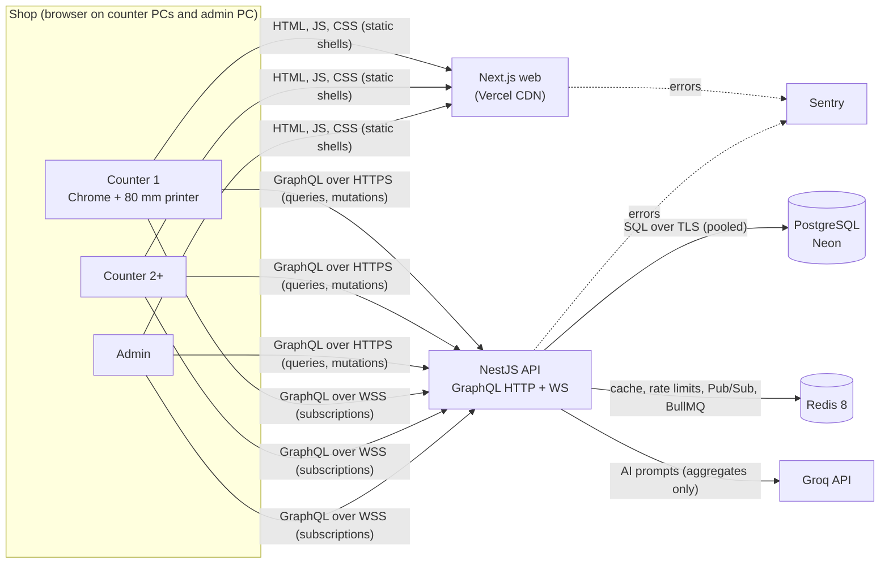
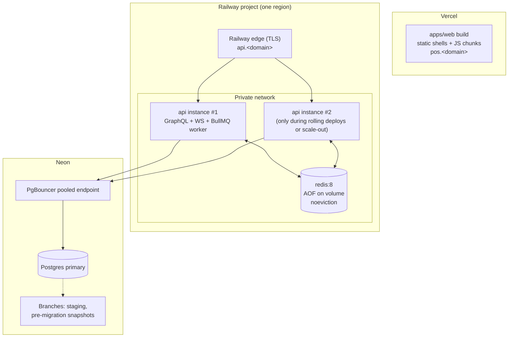
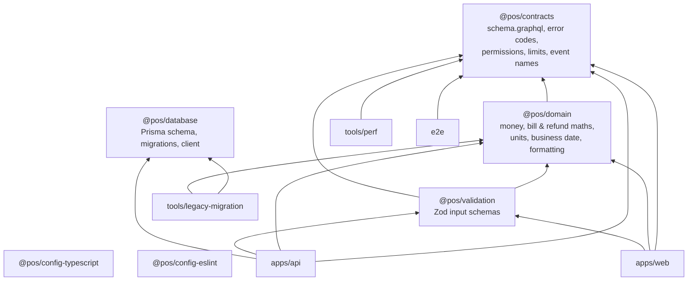
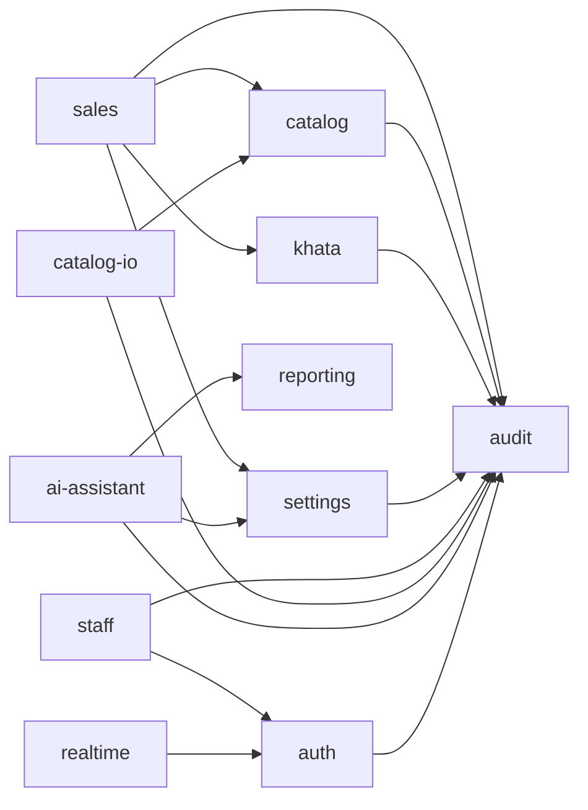
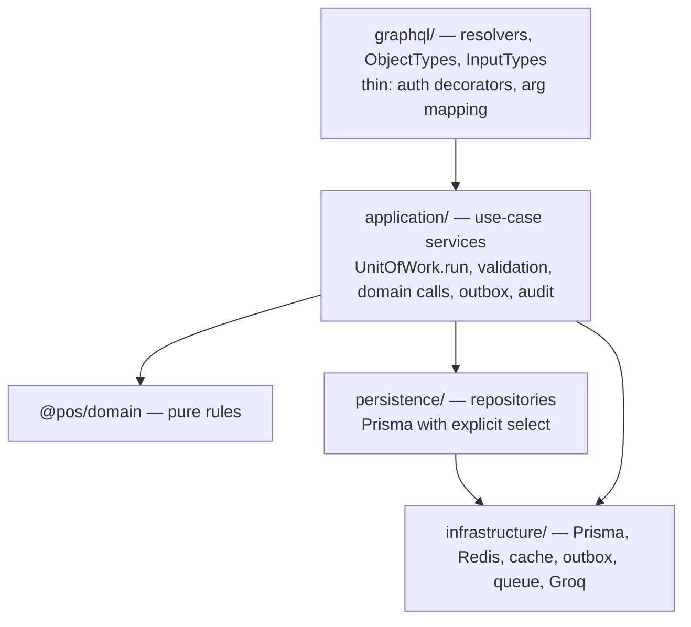
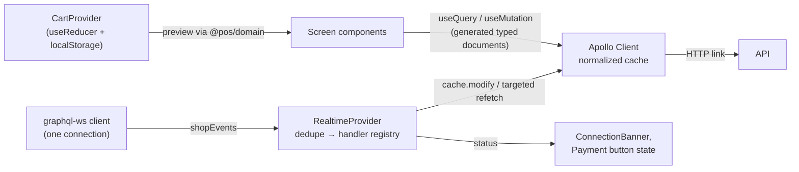

# ARCHITECTURE.md — High-Level Architecture

**Status:** Proposed, awaiting owner review (design stage). Nothing is implemented.
**Last updated:** 2026-10-28
**Related:** [DECISIONS.md](DECISIONS.md) (why) · [SYSTEM_DESIGN.md](SYSTEM_DESIGN.md) (how it behaves) ·
[REPOSITORY_STRUCTURE.md](REPOSITORY_STRUCTURE.md) (every folder and file) · [FEATURES.md](FEATURES.md) (what)

---

## 1. Goals and hard constraints

| Constraint | Source | Architectural answer |
|---|---|---|
| Preserve confirmed features | FEATURES.md §5 | Feature-aligned backend modules and frontend features (§6, §7) |
| Neon transfer was 6–7 GB/month | D-02 | Bounded queries, SQL aggregates, `select` projections, Redis cache for hot reference data |
| No application polling | Brief | One GraphQL subscription per client; event-driven cache patches; targeted refetch on reconnect |
| 50-row backend pagination | Brief | Keyset connections everywhere (API.md §3) |
| Financial correctness | Brief | Postgres transactions, row locks, idempotency keys, DB check constraints, server-side maths |
| One shop, 2+ counters, online only | D-04, D-05 | No tenancy; concurrent-safe sales; billing disabled while offline |
| Redis mandatory | D-26 | Redis from the first infrastructure phase, with defined fallbacks |
| ≤ 200 lines per handwritten file; DRY | Brief | Small use-case files, shared packages, CI checks (CODING_STANDARDS.md) |

---

## 2. System context

Browsers talk to the API **directly** at `api.<domain>`. Traffic does not pass through Vercel functions:
WebSockets cannot, and proxying would add cost and latency (DECISIONS.md ADR-003, ADR-011).

---

## 3. Deployment topology

- Normally **one** API instance runs. During a zero-downtime deploy, two overlap; Redis Pub/Sub lets an event
  committed on either instance reach clients connected to the other.
- The BullMQ worker runs inside the API process (ADR-020). It can move to a separate Railway service
  without code changes (same image, `WORKER_ONLY=true`).
- Staging is a separate Railway environment, a Neon branch and a Vercel preview domain (DEPLOYMENT.md §3).

---

## 4. Component responsibilities

| Component | Responsible for | Not responsible for |
|---|---|---|
| Browser app (`apps/web`) | UI, forms, cart state, cart **preview** totals (via `@pos/domain`), Apollo cache, subscription handling, receipt printing | Authorization, authoritative totals, stock decisions |
| Next.js on Vercel | Serving static shells, JS/CSS chunks, fonts; security headers | Data fetching, sessions, business logic |
| GraphQL HTTP (`POST /graphql`) | All queries and mutations | Push updates |
| GraphQL WS (`wss /graphql`) | `shopEvents` subscription only | Queries, mutations, bulk data |
| REST endpoints | File upload (product import), file download (exports, import template), health, metrics | Business reads/writes that GraphQL covers |
| NestJS API | Authentication, authorization, validation, transactions, calculations, outbox, event publication, rate limits, AI calls, import worker | Rendering UI |
| PostgreSQL (Neon) | **Source of truth**: products, stock, orders, refunds, ledgers, users, sessions, settings, outbox, audit, import staging | Pub/Sub, caching |
| Redis | Session cache, reference-data cache, AI result cache, rate-limit counters, Pub/Sub fan-out, BullMQ queue state | Any record that exists only in Redis; financial or stock truth; locks over money or stock |
| BullMQ worker | Processing staged product-import rows | Sales, stock or ledger writes outside import |
| Groq | Generating AI text from aggregates | Access to raw tables or PII |
| Railway edge / Vercel edge | TLS termination, HTTP/2, WebSocket upgrade | Authentication |
| Sentry, uptime monitor, logs | Errors, availability, structured logs | Business data |

There is no file/object storage (ADR-021) and no separate reverse proxy: Railway and Vercel provide
managed ingress with TLS.

---

## 5. Transport map: which operation uses which transport

| Interaction | Transport | Example |
|---|---|---|
| Navigation-triggered read | HTTP query | `products(first: 50, filter: …)` when a page mounts |
| User-triggered read | HTTP query | Search, "Next page", "Refresh" on Low Stock |
| Barcode scan | HTTP query | `productByBarcode(barcode)` |
| Any write | HTTP mutation | `createSale`, `refundOrder`, `restockProduct` |
| Expensive AI call | HTTP mutation | `aiSalesInsights` (never re-run by reconciliation) |
| Server-pushed change | WS subscription | `shopEvents` → `stock.changed` |
| Reconnect recovery | HTTP queries (active only) | Refetch the visible page plus `productsByIds(cart)` |
| File in / out | REST multipart / streamed download | `POST /v1/imports/products`, `GET /v1/exports/products?format=xlsx` |

Nothing is fetched on a timer. The WebSocket carries protocol pings every 20 s with no business data
(SYSTEM_DESIGN.md §5.6).

---

## 6. Monorepo structure and dependency direction

Full tree: [REPOSITORY_STRUCTURE.md](REPOSITORY_STRUCTURE.md).

Arrows point to dependencies. Every package also uses the config packages. The rules below are enforced
by dependency-cruiser (CODING_STANDARDS.md §4):

1. `apps/web` never imports `apps/api`, `@pos/database` or any server-only package.
2. `@pos/domain` is pure: no I/O and no framework imports. It may use only `decimal.js` (and
   `@pos/contracts`).
3. `@pos/contracts` has no runtime dependencies.
4. `@pos/database` is imported only by `apps/api` (from `persistence/` and `infrastructure/prisma/`) and by
   `tools/legacy-migration`.
5. No cycles anywhere, at package or file level.

---

## 7. Backend architecture (`apps/api`)

### 7.1 Module map and allowed dependencies

| Module | Owns (features) | Tables written |
|---|---|---|
| `auth` | Login, logout, `me`, change password, sessions (F-01, F-03) | `sessions`, `users.password_*` |
| `staff` | Staff accounts (F-31) | `users` |
| `settings` | Shop profile, default GST, Groq key (F-30) | `shop_settings` |
| `catalog` | Categories, products, clone, restock, adjustments, low stock (F-08–F-10, F-12, F-13, F-32) | `categories`, `products`, `stock_movements` |
| `sales` | Sale creation, bill numbers, receipts, order history, refunds (F-15, F-16, F-19–F-23, F-33, F-34) | `orders`, `order_lines`, `refunds`, `refund_lines`, `bill_number_counters` (+ stock via `SaleStockService`, khata via `CustomersService`) |
| `khata` | Customer and vendor khata with one ledger engine (F-25, F-26; ADR-037) | `customers`, `customer_ledger_entries`, `vendors`, `vendor_ledger_entries` |
| `reporting` | Dashboard aggregates, read models for AI (F-06, F-07) | none (read-only SQL across tables) |
| `ai-assistant` | Six AI features (F-29) | none (audit only) |
| `catalog-io` | Import, template, exports (F-11, F-13 export) | `import_jobs`, `import_job_rows` (+ catalog via its services) |
| `audit` | Audit writer and (proposed) viewer | `audit_logs` |
| `realtime` | `shopEvents` subscription, WS connection lifecycle | none |
| `health` | Liveness and readiness | none |
| `server-info` | `serverInfo { version businessDate }` (public; terminal header date) | none |

The module graph is enforced by ARCH-01 (`apps/api/src/modules/module-graph.spec.ts`): every module folder is
registered there and its Nest `imports` must equal the edges above.

Cross-module calls go only through the target module's `index.ts` exports (its public services). The
`reporting` module is the one documented exception: it reads other modules' tables directly through
read-only SQL, because aggregates across tables cannot be composed efficiently from other modules'
services. It never writes.

### 7.2 Layers inside a module

- **Resolvers** never touch Prisma, Redis or domain maths directly.
- **Application services** hold use-case logic. One file per use case once a service would exceed about
  150 lines.
- **Repositories** return plain typed records (DTOs), never Prisma models with lazy relations, and never
  publish events.
- **`common/`** (errors, pagination, scalars, guards, decorators, logging) and **`infrastructure/`** never import
  `modules/`.

### 7.3 Request pipeline (HTTP)

`helmet` → CORS → body limit → `pino-http` (request id) → Apollo CSRF check → GraphQL validation
(depth/complexity) → `SessionGuard` (cookie → principal: Redis, then Postgres) → `PermissionGuard`
(`@RequirePermission`) → `ThrottlerGuard` → `ZodValidationPipe` → resolver → service (transaction) →
after-commit outbox publish → response (gzip/brotli when > 1 KB).

---

## 8. Frontend architecture (`apps/web`)

### 8.1 Route groups and rendering

| Route | Group / layout | Rendering | Why |
|---|---|---|---|
| `/login` | `(auth)` | Static server page + client form | No data; form needs interactivity |
| `/` | — | Client redirect by role after `me` | Role known only after `me` |
| `/terminal`, `/terminal/payment` | `(app)/terminal` layout (header, `CartProvider`) | Static shell + client screens | Live stock, cart state, scanner input |
| `/dashboard`, `/products`, `/categories`, `/categories/[id]`, `/low-stock`, `/orders`, `/customers`, `/customers/[id]`, `/vendors`, `/vendors/[id]`, `/staff`, `/settings`, `/ai`, `/ai/[feature]`, `/activity` (proposed) | `(app)/(admin)` layout (sidebar, badge) | Static shell + client screens | Authenticated, live data in the Apollo cache |
| `not-found`, `error`, `global-error` | root | Server (static) / client boundary | — |

The `(app)` layout mounts `AppProviders` (Apollo client, realtime connection, viewer gate, theme, toasts)
**once**. Client navigations keep the Apollo cache and the single WebSocket connection alive.

### 8.2 Client-side data flow

### 8.3 Frontend state

| State | Where | Notes |
|---|---|---|
| Server data | Apollo cache | Fetch policies in NETWORK_OPTIMIZATION.md §6 |
| Viewer (user, role, permissions) | Apollo cache (`me`) | `useViewer()`, `useCan(permission)` |
| Cart | `CartProvider` (terminal layout) | Persisted per user in `localStorage`; cleared after a confirmed sale |
| Pending sale (in-flight idempotency key) | `localStorage` | Used to confirm the outcome after a refresh or network failure (SYSTEM_DESIGN.md §3.4) |
| Connection status | `RealtimeProvider` context | `connected` / `reconnecting` / `offline` |
| Theme | `next-themes` | — |
| Form state | React Hook Form | Zod resolver from `@pos/validation` |

---

## 9. Real-time architecture (summary)

One subscription per browser tab: `shopEvents`. The server chooses Redis channels from the viewer's role
(`staff`, `admin`, `user:{id}`), so unauthorized events never reach the socket. Writes insert events into
the outbox in the same transaction, then publish after commit. Clients patch the Apollo cache by entity
`version`, de-duplicate by `seq`, and after any disconnect refetch only active queries. Details, payloads and
failure handling: [SYSTEM_DESIGN.md §5](SYSTEM_DESIGN.md), [API.md §7](API.md).

---

## 10. PostgreSQL vs Redis responsibilities

| Concern | PostgreSQL | Redis |
|---|---|---|
| Products, stock, prices | Source of truth | Not cached (stock), category list cached |
| Orders, refunds, ledgers | Source of truth | Never stored |
| Sessions | Source of truth (`sessions`) | 5-min principal cache, revocation tombstones |
| Settings | Source of truth | 1-h cache (without the API key) |
| Events | `outbox_events` (durable, 7 days) | Pub/Sub transport (not durable) |
| Import jobs | `import_jobs`/`import_job_rows` (state) | BullMQ queue (trigger and retries) |
| Rate limits | — | Counters with TTL |
| AI results | — | 15-min cache |

If Redis is lost entirely, no business data is lost (SYSTEM_DESIGN.md §6.5).

---

## 11. Quality attributes

| Attribute | How it is achieved | Verified by |
|---|---|---|
| Correctness | Transactions, row locks, idempotency, DB checks, shared maths | TESTING.md FIN-01–FIN-22 |
| Bandwidth | Projections, keyset pages, SQL aggregates, tiny events, no polling, caching | NETWORK_OPTIMIZATION.md budgets |
| Availability | Stateless API, Redis-independent sales path, graceful shutdown, health checks | TESTING.md RED-*, DEPLOYMENT.md §8 |
| Security | Server-side authz, cookie sessions, CSRF/WS origin checks, rate limits, audit | TESTING.md SEC-* |
| Maintainability | Module boundaries, ≤ 200-line files, shared packages, generated types | CI gates (CODING_STANDARDS.md §8) |
