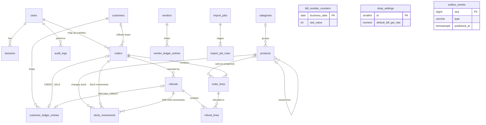

# DATABASE.md — PostgreSQL Design

**Status:** Proposed, awaiting owner review (design stage). No schema exists yet.
**Last updated:** 2026-10-28
**Related:** [FEATURES.md](FEATURES.md) (rules BR-xx, decisions D-xx) · [SYSTEM_DESIGN.md](SYSTEM_DESIGN.md) (flows) ·
[DECISIONS.md](DECISIONS.md) ADR-005/006/013–017

---

## 1. Principles

1. **PostgreSQL (Neon) is the only source of truth** for products, stock, orders, refunds, payments,
   ledgers, users, sessions and settings. Redis never holds a record that is not also here (ADR-007).
2. **Money** is `numeric(12,2)`; rates are `numeric(5,2)` percentages (0–100). Floating-point types never
   store money.
3. **Derived totals are checked by the database.** For example, the order total must equal its components,
   enforced by a `CHECK` constraint.
4. **Primary keys:** UUIDv7 (`uuid`) for business entities. Use Prisma `@default(uuid(7))` if the pinned
   Prisma version supports it; otherwise generate in the app with the `uuid` package. High-volume internal
   rows (movements, ledger entries, order lines, outbox, audit) use `bigint GENERATED ALWAYS AS IDENTITY`,
   exposed in GraphQL as `ID` strings.
5. **Timestamps** are `timestamptz` (UTC). `business_date` is a `date` in Asia/Karachi, computed by the API
   when the row is created (`@pos/domain/time/business-date.ts`).
6. **Naming:** snake_case tables (plural) and columns, mapped from camelCase Prisma models with
   `@@map`/`@map`. Constraint and index names are explicit: `<table>_<cols>_<kind>` (`_pk`, `_uq`, `_fk`, `_ck`, `_idx`).
7. **Optimistic concurrency:** editable entities have `version int NOT NULL DEFAULT 1`. Updates use
   `WHERE id = $1 AND version = $2` and increment it; zero updated rows means `CONFLICT`.
8. **Archive, never delete** financial rows (D-12, ADR-028). Archivable entities have `archived_at`. A row
   no bill or khata entry depends on may be deleted (D-28, ADR-046).
9. **Extensions:** `pg_trgm` (substring search) and `citext` (case-insensitive unique names).
10. **Legacy mapping:** migrated tables carry `legacy_id varchar(64)` with a partial unique index, which
    makes the migration idempotent (§11).

---

## 2. Entity relationship diagram

---

## 3. Enums

| Enum | Values | Used by |
|---|---|---|
| `user_role` | `ADMIN`, `CASHIER` | users |
| `user_status` | `ACTIVE`, `DISABLED` | users |
| `sale_unit` | `PIECE`, `BOX` | order_lines, products (threshold unit) |
| `payment_method` | `CASH`, `CARD`, `EASYPAISA`, `JAZZCASH`, `BANK_TRANSFER`, `UDHAAR` | orders, refunds, ledger payments |
| `discount_type` | `NONE`, `FLAT`, `PERCENT` | orders |
| `order_status` | `COMPLETED`, `PARTIALLY_REFUNDED`, `REFUNDED` (Q23 default) | orders |
| `refund_settlement` | `ORIGINAL_METHOD`, `KHATA_CREDIT` | refunds |
| `stock_movement_type` | `OPENING`, `SALE`, `REFUND`, `RESTOCK`, `ADJUSTMENT_INCREASE`, `ADJUSTMENT_DECREASE`, `MIGRATION` | stock_movements |
| `adjustment_reason` | `DAMAGED`, `LOST`, `COUNT_CORRECTION`, `OTHER` | stock_movements (D-18) |
| `customer_entry_type` | `OPENING_BALANCE`, `CREDIT_SALE`, `MANUAL_CREDIT`, `PAYMENT`, `REFUND_CREDIT` | customer_ledger_entries |
| `vendor_entry_type` | `OPENING_BALANCE`, `PURCHASE`, `PAYMENT` | vendor_ledger_entries |
| `import_kind` | `PRODUCTS` | import_jobs |
| `import_status` | `QUEUED`, `RUNNING`, `COMPLETED`, `FAILED` | import_jobs |
| `import_row_status` | `PENDING`, `SUCCEEDED`, `FAILED`, `SKIPPED` | import_job_rows |

The same value sets are exported as TypeScript unions from `@pos/contracts/enums.ts`. A unit test asserts
the Prisma enums and the contracts unions are identical.

---

## 4. Tables

Prisma schema files (each ≤ 200 lines): `base.prisma` (generator, datasource, extensions),
`auth.prisma`, `catalog.prisma`, `sales.prisma`, `khata.prisma`, `system.prisma`.

### 4.1 `users` (auth.prisma)
Purpose: staff accounts (D-10).

| Column | Type | Null | Notes |
|---|---|---|---|
| id | uuid | no | PK |
| username | citext | no | unique; 3–40 chars `[a-z0-9._-]` (`_ck`) |
| full_name | varchar(120) | no | |
| password_hash | text | no | argon2id PHC string |
| role | user_role | no | |
| status | user_status | no | default `ACTIVE` |
| password_changed_at | timestamptz | no | |
| created_by_id | uuid | yes | FK users |
| created_at, updated_at | timestamptz | no | |
| version | int | no | optimistic lock |

Invariant: at least one `ACTIVE` `ADMIN` must exist. Enforced in the staff service by locking admin rows
(`SELECT … FOR UPDATE`) before disabling or demoting an admin.

### 4.2 `sessions` (auth.prisma)
Purpose: server-side sessions (ADR-011).

| Column | Type | Null | Notes |
|---|---|---|---|
| id | uuid | no | PK |
| user_id | uuid | no | FK users (RESTRICT) |
| token_hash | bytea | no | SHA-256 of the cookie token; unique |
| created_at, last_seen_at | timestamptz | no | `last_seen_at` is touched at most once per 15 min |
| idle_expires_at, absolute_expires_at | timestamptz | no | 12 h idle, 7 days absolute |
| revoked_at | timestamptz | yes | |
| revoke_reason | varchar(32) | yes | `LOGOUT`, `PASSWORD_CHANGED`, `DISABLED`, `ADMIN_RESET`, `ROLE_CHANGED` |
| ip | inet | yes | |
| user_agent | varchar(200) | yes | truncated |

Indexes: `sessions_token_hash_uq`; `sessions_user_idx (user_id)` (plain, Prisma-managed: revocation reads all of a user's sessions).
Checks: `revoked_at` and `revoke_reason` set together; `idle_expires_at ≤ absolute_expires_at`.
Retention: expired/revoked rows older than 30 days are deleted on login (prune-on-write, ≤ 500 rows each time).

### 4.3 `shop_settings` (system.prisma)
Purpose: single-row shop profile (Q26 default) and AI key (D-22).

| Column | Type | Null | Notes |
|---|---|---|---|
| id | smallint | no | PK, `CHECK (id = 1)` |
| shop_name | varchar(120) | no | inserted by the first migration |
| address, receipt_footer | varchar(300) | yes | |
| phone | varchar(30) | yes | |
| default_bill_gst_rate | numeric(5,2) | no | default `18.00`, `CHECK 0–100` (BR-07) |
| groq_api_key_ciphertext | bytea | yes | AES-256-GCM (nonce‖ciphertext‖tag) |
| groq_api_key_last4 | varchar(4) | yes | the only key fragment ever returned; `shop_settings_ai_key_ck`: set and cleared together with the ciphertext, exactly 4 characters (F-30) |
| updated_at | timestamptz | no | |
| updated_by_id | uuid | yes | FK users |
| version | int | no | |

### 4.4 `categories` (catalog.prisma)

| Column | Type | Null | Notes |
|---|---|---|---|
| id | uuid | no | PK |
| name | citext | no | unique, 1–80 chars |
| icon_emoji | varchar(16) | yes | |
| description | varchar(200) | yes | |
| created_at, updated_at, version | | no | |
| legacy_id | varchar(64) | yes | partial unique |

Indexes: `categories_name_uq`; `categories_name_id_idx (name, id)` for keyset paging.
Delete: the service moves products to `category_id = NULL` (Uncategorised) and then deletes the row in the
same transaction (Q16b). The FK is `RESTRICT`, so this can never happen implicitly.

### 4.5 `products` (catalog.prisma)
Purpose: catalogue and current stock (F-08–F-10, D-17, D-19).

| Column | Type | Null | Notes |
|---|---|---|---|
| id | uuid | no | PK |
| barcode | varchar(64) | yes | trimmed; unique among active products |
| name | varchar(200) | no | |
| name_key | varchar(200) | no | `normalizeNameKey(name)`: lower-case, trimmed, single spaces; used for sorting and search |
| name_urdu | varchar(200) | yes | |
| category_id | uuid | yes | FK categories (RESTRICT); NULL = Uncategorised |
| base_unit_label | varchar(20) | no | default `'Piece'` (Q29) |
| pieces_per_box | int | no | default 1, `CHECK 1–10000` |
| sale_price | numeric(12,2) | no | per piece, `≥ 0` |
| box_price | numeric(12,2) | yes | `≥ 0`; `CHECK (box_price IS NULL OR pieces_per_box > 1)` (D-17, A-08) |
| cost_price | numeric(12,2) | yes | `≥ 0`; admin-only in the API |
| tax_rate | numeric(5,2) | no | default `0` (Q32), `CHECK 0–100` |
| low_stock_threshold_pieces | int | no | default 10, `≥ 0` |
| low_stock_threshold_unit | sale_unit | no | display only; the threshold is stored in pieces |
| stock_pieces | int | no | default 0; **may be negative** (D-16) |
| cloned_from_id | uuid | yes | FK products (D-19) |
| idempotency_key | uuid | yes | unique; makes create and clone retry-safe |
| request_hash | bytea | yes | SHA-256 of the create/clone input; set together with `idempotency_key` (CHECK) |
| archived_at | timestamptz | yes | soft archive |
| created_at, updated_at, version | | no | |
| legacy_id | varchar(64) | yes | partial unique |
| legacy_barcode | varchar(128) | yes | original value when the barcode could not be kept (Q35) |

Indexes (each tied to a query in §5):

| Index | Definition | Serves |
|---|---|---|
| `products_barcode_active_uq` | `UNIQUE (barcode) WHERE barcode IS NOT NULL AND archived_at IS NULL` | Scanner lookup; uniqueness |
| `products_active_name_idx` | `(name_key, id) WHERE archived_at IS NULL` | Default list and terminal grid sort |
| `products_active_category_name_idx` | `(category_id, name_key, id) WHERE archived_at IS NULL` | Category chips, category detail |
| `products_active_price_idx` | `(sale_price, id) WHERE archived_at IS NULL` | Price sorts |
| `products_low_stock_idx` | `(stock_pieces, id) WHERE archived_at IS NULL AND stock_pieces <= low_stock_threshold_pieces` | Low-stock list, count, badge |
| `products_name_key_trgm_idx` | `GIN (name_key gin_trgm_ops)` | Substring search |
| `products_name_urdu_trgm_idx` | `GIN (name_urdu gin_trgm_ops)` | Urdu search |

The low-stock rule (stock ≤ threshold, BR-02) appears **only** in this index predicate and in
`@pos/domain/stock/low-stock.ts`. Prisma queries express it with field references
(`stockPieces: { lte: prisma.product.fields.lowStockThresholdPieces }`).

### 4.6 `stock_movements` (catalog.prisma)
Purpose: an append-only ledger of every stock change (ADR-016).

| Column | Type | Null | Notes |
|---|---|---|---|
| id | bigint identity | no | PK |
| product_id | uuid | no | FK products |
| type | stock_movement_type | no | |
| quantity_pieces | int | no | signed, `≠ 0` |
| balance_after | int | no | `products.stock_pieces` after this movement |
| reason | adjustment_reason | yes | required for `ADJUSTMENT_*` |
| note | varchar(200) | yes | |
| order_id / refund_id | uuid | yes | FK; required for `SALE` / `REFUND` |
| import_job_id | uuid | yes | FK import_jobs |
| idempotency_key | uuid | yes | unique; for restock and adjustment |
| request_hash | bytea | yes | SHA-256 of the restock/adjust input, compared on replay (§7) |
| actor_user_id | uuid | yes | FK users |
| created_at | timestamptz | no | |

Checks: `SALE`, `ADJUSTMENT_DECREASE` → quantity < 0; `REFUND`, `RESTOCK`, `ADJUSTMENT_INCREASE`, `OPENING` →
quantity > 0; `ADJUSTMENT_*` → reason not null; `SALE` → order_id not null; `REFUND` → refund_id not null.
Index: `stock_movements_product_created_idx (product_id, created_at DESC, id DESC)`.

### 4.7 `customers` and `vendors` (khata.prisma)

| Column | Type | Null | Notes |
|---|---|---|---|
| id | uuid | no | PK |
| name | varchar(120) | no | |
| name_key | varchar(120) | no | normalized, for sort and search |
| phone | varchar(30) | yes | as entered |
| phone_digits | varchar(20) | yes | digits only (`@pos/domain/format/phone.ts`), for search |
| email | varchar(254) | yes | |
| address | varchar(300) | yes | |
| products_supplied | varchar(300) | yes | **vendors only** |
| balance | numeric(12,2) | no | default 0. Customers: + means the customer owes the shop, − is an advance (Q25). Vendors: + means the shop owes the vendor |
| archived_at | timestamptz | yes | archiving requires balance = 0 (Q33 default) |
| created_at, updated_at, version, legacy_id | | | |

Indexes (per table): `(name_key, id) WHERE archived_at IS NULL`; `GIN (name_key gin_trgm_ops)`;
`(phone_digits) WHERE phone_digits IS NOT NULL`.

### 4.8 `customer_ledger_entries` and `vendor_ledger_entries` (khata.prisma)
Purpose: append-only khata ledgers with running balance (F-25, F-26).

| Column | Type | Null | Notes |
|---|---|---|---|
| id | bigint identity | no | PK |
| customer_id / vendor_id | uuid | no | FK |
| type | customer_entry_type / vendor_entry_type | no | |
| amount | numeric(12,2) | no | signed, `≠ 0`; + increases the balance |
| balance_after | numeric(12,2) | no | |
| payment_method | payment_method | yes | required for `PAYMENT`; never `UDHAAR` |
| note | varchar(300) | yes | vendor `PURCHASE` description lives here |
| order_id, refund_id | uuid | yes | **customer ledger only**; FK |
| idempotency_key | uuid | yes | unique |
| business_date | date | no | |
| actor_user_id | uuid | yes | FK users |
| created_at | timestamptz | no | |
| legacy_id | varchar(64) | yes | |

Customer checks: `CREDIT_SALE`, `MANUAL_CREDIT` → amount > 0; `PAYMENT`, `REFUND_CREDIT` → amount < 0;
`CREDIT_SALE` → order_id not null; `REFUND_CREDIT` → refund_id not null. Unique partial indexes:
`(order_id) WHERE type = 'CREDIT_SALE'` and `(refund_id) WHERE type = 'REFUND_CREDIT'`.
Vendor checks: `PURCHASE` → amount > 0; `PAYMENT` → amount < 0.
Index: `(customer_id | vendor_id, created_at DESC, id DESC)`.

### 4.9 `bill_number_counters` (sales.prisma)

| Column | Type | Notes |
|---|---|---|
| business_date | date | PK |
| last_value | int | `> 0` |

### 4.10 `orders` (sales.prisma)
Purpose: an immutable bill header with a financial snapshot (F-15, F-19–F-22).

| Column | Type | Null | Notes |
|---|---|---|---|
| id | uuid | no | PK |
| bill_number | varchar(24) | no | unique (`orders_bill_number_uq`); `ORD-YYYYMMDD-NNN`. Prefix search uses the separate partial index `orders_bill_number_prefix_idx` (`varchar_pattern_ops`, ADR-038) |
| business_date | date | no | |
| idempotency_key | uuid | no | unique (ADR-015) |
| request_hash | bytea | yes | NULL only for migrated rows |
| cashier_id | uuid | yes | FK users; NULL for migrated rows (A-07) |
| cashier_name | varchar(120) | no | snapshot |
| customer_id | uuid | yes | FK customers; required for `UDHAAR` |
| payment_method | payment_method | no | one method per bill (BR-09) |
| discount_type | discount_type | no | |
| discount_value | numeric(12,2) | no | flat amount, or percent (≤ 100) |
| subtotal | numeric(12,2) | no | Σ line_gross |
| discount_total | numeric(12,2) | no | Σ line_discount, `≤ subtotal` |
| item_discount_total | numeric(12,2) | no | default 0; Σ item_discount, the part of `discount_total` given on items (D-27) |
| product_tax_total | numeric(12,2) | no | Σ line_tax |
| bill_gst_rate | numeric(5,2) | yes | NULL = not applied |
| bill_gst_amount | numeric(12,2) | no | default 0 |
| total | numeric(12,2) | no | |
| refunded_total | numeric(12,2) | no | default 0 |
| status | order_status | no | |
| created_at | timestamptz | no | |
| version | int | no | incremented by refunds |
| legacy_id | varchar(64) | yes | |

Checks: `total = subtotal - discount_total + product_tax_total + bill_gst_amount`;
`refunded_total BETWEEN 0 AND total`; `payment_method <> 'UDHAAR' OR customer_id IS NOT NULL`;
`bill_gst_rate IS NOT NULL OR bill_gst_amount = 0`; `discount_type <> 'NONE' OR (discount_value = 0 AND discount_total = item_discount_total)`;
`item_discount_total BETWEEN 0 AND discount_total`;
`discount_type <> 'PERCENT' OR discount_value <= 100`.
Indexes: `orders_created_idx (created_at DESC, id DESC)`; `orders_status_created_idx (status, created_at DESC, id DESC)`;
`orders_business_date_idx (business_date)`.

### 4.11 `order_lines` (sales.prisma)

| Column | Type | Null | Notes |
|---|---|---|---|
| id | bigint identity | no | PK |
| order_id | uuid | no | FK orders |
| line_no | smallint | no | unique per order; ≤ 100 lines (Q34) |
| product_id | uuid | yes | FK products; NULL only for migrated lines without a product |
| product_name, product_name_urdu, barcode | varchar | | snapshots |
| sale_unit | sale_unit | no | |
| pieces_per_unit | int | no | 1 for `PIECE`; pieces_per_box at sale time for `BOX` |
| quantity | int | no | units sold, `1–10000` |
| unit_price | numeric(12,2) | no | piece or box price at sale time |
| tax_rate | numeric(5,2) | no | snapshot |
| line_gross, line_discount, line_net, line_tax | numeric(12,2) | no | `line_discount` is the item discount plus this line's share of the overall one |
| item_discount | numeric(12,2) | no | default 0; this item's own discount (D-27) |
| refunded_quantity | int | no | default 0 |

Checks: `line_gross = unit_price * quantity`; `line_net = line_gross - line_discount`;
`line_discount BETWEEN 0 AND line_gross`; `item_discount BETWEEN 0 AND line_discount`; `refunded_quantity BETWEEN 0 AND quantity`;
`sale_unit = 'BOX' OR pieces_per_unit = 1`.

### 4.12 `refunds` and `refund_lines` (sales.prisma)

| `refunds` column | Type | Notes |
|---|---|---|
| id | uuid | PK |
| order_id | uuid | FK orders |
| idempotency_key | uuid | unique |
| request_hash | bytea | |
| business_date | date | refunds count on the refund date (Q28 default) |
| amount | numeric(12,2) | `> 0`; = Σ refund_lines.amount + bill_gst_share |
| bill_gst_share | numeric(12,2) | `≥ 0` |
| settlement | refund_settlement | `KHATA_CREDIT` for Udhaar orders (A-03) |
| payment_method | payment_method | copied from the order |
| reason | varchar(200) | optional (Q7b) |
| actor_user_id | uuid | FK users |
| created_at | timestamptz | |

`refund_lines`: `id` bigint identity; `refund_id` FK; `order_line_id` FK; `quantity > 0`; `amount ≥ 0`
(line net + product tax share). Unique `(refund_id, order_line_id)`.
Indexes: `refunds_order_idx (order_id, created_at)`, `refunds_business_date_idx (business_date)`.

### 4.13 `outbox_events` (system.prisma)
Purpose: durable event publication (ADR-009).

| Column | Type | Notes |
|---|---|---|
| seq | bigint identity | PK; de-duplication key for clients |
| type | varchar(48) | e.g. `stock.changed` (API.md §7) |
| audience | varchar(64) | `staff`, `admin`, `user:<uuid>` |
| schema_version | smallint | payload version |
| payload | jsonb | small; no PII beyond ids and balances |
| created_at | timestamptz | |
| published_at | timestamptz | NULL until published |

Indexes: `outbox_unpublished_idx (seq) WHERE published_at IS NULL`; `outbox_created_idx (created_at)`.

### 4.14 `audit_logs` (system.prisma)

| Column | Type | Notes |
|---|---|---|
| id | bigint identity | PK |
| actor_user_id | uuid | nullable (failed logins) |
| action | varchar(64) | e.g. `product.updated` (SYSTEM_DESIGN.md §9.3) |
| entity_type, entity_id | varchar | nullable |
| metadata | jsonb | before/after for changed fields; **never** passwords, tokens, keys |
| ip | inet | |
| request_id | varchar(64) | correlates with logs |
| created_at | timestamptz | |

Indexes: `(created_at DESC, id DESC)`, `(entity_type, entity_id, created_at DESC)`, `(actor_user_id, created_at DESC)`.

### 4.15 `import_jobs` and `import_job_rows` (system.prisma)
`import_jobs`: id, kind, status, file_name, total_rows, processed_rows, succeeded_rows, failed_rows,
created_by_id, created_at, started_at, finished_at, error_summary.
`import_job_rows`: id bigint, job_id FK, row_number, data jsonb (parsed row), status, error varchar(300),
product_id uuid. Unique `(job_id, row_number)`; index `(job_id, status, row_number)`.
Retention: rows of jobs finished more than 30 days ago are deleted when a new import is staged.
CHECKs (migration `20261031162903_import_jobs`): total rows 0–5,000, processed ≤ total, succeeded + failed ≤
processed; `finished_at` set exactly when the job is COMPLETED or FAILED; row numbers ≥ 1; a FAILED row has an
error, a SUCCEEDED row a product. `stock_movements.import_job_id` is now a foreign key to `import_jobs`.

---

## 5. Query patterns and the indexes they use

| Query (API.md) | SQL shape | Index |
|---|---|---|
| `products` default page | `WHERE archived_at IS NULL AND (name_key, id) > ($k,$id) ORDER BY name_key, id LIMIT 51` | `products_active_name_idx` |
| `products` by category | same + `category_id = $c` | `products_active_category_name_idx` |
| `products(search:)` | `name_key LIKE '%term%' OR name_urdu LIKE '%term%' OR barcode = $t` | trigram GIN + barcode unique |
| `productByBarcode` | `barcode = $1 AND archived_at IS NULL` | `products_barcode_active_uq` |
| `lowStockProducts`, `lowStockCount` | `stock_pieces <= low_stock_threshold_pieces AND archived_at IS NULL` | `products_low_stock_idx` |
| `orders` history | keyset on `(created_at DESC, id DESC)`, default `created_at ≥ now() - 90 days` | `orders_created_idx` / `orders_status_created_idx` |
| `orders(billNumberPrefix:)` | `bill_number LIKE 'ORD-20261028%'` | `orders_bill_number_prefix_idx` (pattern ops, partial `WHERE bill_number IS NOT NULL` so Prisma does not report drift) |
| `customerLedger` | `customer_id = $1` keyset `(created_at DESC, id DESC)` | ledger index |
| Dashboard aggregates | `GROUP BY` over `business_date` ranges (TypedSQL) | `orders_business_date_idx`, `refunds_business_date_idx` |

Every list query selects only the columns its GraphQL fragment needs and fetches `first + 1` rows to compute
`hasNextPage`. Aggregates are computed in SQL: Neon bills **result bytes**, so a `GROUP BY` returning 12 rows
costs about 1 KB no matter how many rows it scans.

---

## 6. Transaction boundaries and concurrency

All use cases run in `READ COMMITTED` with explicit row locks. The transaction wrapper sets
`SET LOCAL lock_timeout = '3s'` and `SET LOCAL statement_timeout = '10s'`. It retries the whole transaction
up to 3 times on `40001` (serialization failure) or `40P01` (deadlock), with jittered backoff of 20–200 ms.
Retries are safe because every financial mutation is idempotent (§7).

| Use case | Writes | Lock order (deadlock-free) | Events (outbox, same tx) |
|---|---|---|---|
| `createSale` | counter, orders, order_lines, products.stock, stock_movements, [customers, customer_ledger_entries] | products `FOR UPDATE` by **ascending id** → counter upsert → customer row | `stock.changed`, `order.created`, [`customer.balanceChanged`] |
| `refundOrder` | orders, order_lines.refunded_quantity, refunds, refund_lines, products.stock, stock_movements, [customer ledger], audit | order `FOR UPDATE` → products by ascending id → customer | `order.refunded`, `stock.changed`, [`customer.balanceChanged`] |
| `restockProduct`, `adjustStock` | products.stock, stock_movements, audit | product row (`FOR UPDATE`, active only) | `stock.changed`, [`lowStock.countChanged`] on a threshold crossing |
| `createProduct`, `cloneProduct` | products, [stock_movements `OPENING`], audit | — | `product.changed`, [`lowStock.countChanged`] if it starts low |
| `updateProduct` | products (version check), audit (changed field names) | product row | `product.changed`, [`lowStock.countChanged`] |
| `archiveProduct`, `restoreProduct` | products.archived_at, audit | product row | `product.changed`, [`lowStock.countChanged`] |
| `deleteProduct` | stock_movements, import_job_rows and products (deleted), clones' cloned_from_id, audit | product row, so a sale at another counter either finishes first (refused) or finds no product | `product.changed` (`DELETED`), [`lowStock.countChanged`] |
| `deleteCustomer`, `deleteVendor` | customers or vendors (deleted), audit | none: the version check and foreign keys refuse an entry or bill landing in between | none |
| `deleteStaffUser` | sessions (revoked, deleted), audit_logs.actor_user_id of sign-in rows (nulled), users (deleted), audit | target and active admins, ascending | `session.revoked` |
| `deleteCategory` | products.category_id → NULL (version + 1), categories, audit | — (FK `RESTRICT` refuses a concurrent insert into the category: `CONFLICT`) | `category.changed` |
| Customer payment / manual credit | customers.balance, customer_ledger_entries, audit | customer row | `customer.balanceChanged` |
| Vendor purchase / payment | vendors.balance, vendor_ledger_entries, audit | vendor row | `vendor.balanceChanged` |
| Staff disable / role change / reset | users, sessions (revoke), audit | admin rows when touching an admin | `session.revoked` |
| Import batch (≤ 100 rows) | products, stock_movements, import_job_rows, import_jobs | product rows | at job end: `catalog.bulkChanged`; per batch: `import.progressed` |

Key invariants and how they hold under concurrency:

- **Stock:** `UPDATE products SET stock_pieces = stock_pieces + $delta, version = version + 1 WHERE id = $id
  RETURNING stock_pieces, low_stock_threshold_pieces, version`. The row lock serializes concurrent sales, so
  no update is lost. Locking in ascending id order prevents two multi-line sales from deadlocking.
- **Bill numbers:** the counter row lock serializes allocation. A rollback also rolls back the increment,
  so numbers are gapless for committed bills.
- **Refund limits:** the order row is locked first. `refunded_quantity ≤ quantity` and
  `refunded_total ≤ total` are checked by the database. Two concurrent refunds of the last unit therefore
  serialize: one succeeds and the other gets `REFUND_EXCEEDS_REMAINING`.
- **Khata balances:** `UPDATE … SET balance = balance + $amount RETURNING balance` gives `balance_after`
  atomically.
- **Totals:** computed by `@pos/domain` from **locked** product rows, then cross-checked by `CHECK` constraints.
  Client totals are only compared (`expectedTotal`), never stored.

---

## 7. Idempotency

| Mutation | Key column | On replay |
|---|---|---|
| `createSale` | `orders.idempotency_key` | Same `request_hash` → return the stored order and receipt with `replayed: true`. Different hash → `IDEMPOTENCY_KEY_REUSED` |
| `refundOrder` | `refunds.idempotency_key` | Same |
| `restockProduct`, `adjustStock` | `stock_movements.idempotency_key` | Same |
| `createProduct`, `cloneProduct` | `products.idempotency_key` | Same |
| Khata entries | `*_ledger_entries.idempotency_key` | Same |

Implementation: insert inside the transaction; on unique violation `P2002` for the key, roll back, load the
existing row and compare `request_hash` (SHA-256 of the canonical JSON input, `common/idempotency/request-hash.ts`).

---

## 8. Archival and retention (D-12)

| Data | Policy |
|---|---|
| Orders, refunds, ledger entries, stock movements, audit logs | Kept forever. Lists default to the last 90 days; "Show archived" removes the lower bound |
| Products, customers, vendors | `archived_at` soft archive. Hidden by default; restorable. Never hard-deleted once a bill or khata entry references them; before that, Delete removes them (D-28) |
| Categories | Hard-deleted after their products move to Uncategorised (no financial references) |
| Sessions | Expired/revoked rows pruned after 30 days (on login) |
| Outbox | Published rows pruned after 7 days (prune-on-write, ADR-009) |
| Import rows | Pruned 30 days after job completion (when a new import is staged) |

---

## 9. Migrations

1. **Tooling:** Prisma Migrate. Develop with `prisma migrate dev --create-only`, review and append custom SQL
   (checks, partial/trigram indexes, `varchar_pattern_ops`, seed row for `shop_settings`), then apply.
2. **One concern per migration**, each `migration.sql` ≤ 200 lines (counted by `check:file-size`). Phases add
   their own tables, which keeps files small naturally.
3. **Forward-only.** No down migrations. Rollback uses expand/contract plus a Neon pre-migration branch.
4. **Expand/contract** for breaking changes: (a) add nullable/new structures, (b) deploy code writing both,
   (c) backfill in batches, (d) enforce constraints, (e) remove old structures in a later release.
5. **Destructive SQL** (`DROP`, type narrowing, `NOT NULL` on populated columns) is only allowed in a contract
   migration with CODEOWNERS approval and a Neon branch snapshot taken first (DEPLOYMENT.md §6).
6. **Environments:** `migrate dev` and `migrate reset` only against local Docker. The `db:*` scripts refuse
   to run when `DATABASE_URL` does not point at `localhost`. Neon development, staging and production use
   `prisma migrate deploy` with `DIRECT_DATABASE_URL`; keep development and production on separate branches.
   Integration tests still require a separate local test database. Never point the new schema at the legacy database.
7. **Verified behaviour (Phase 2):** hand-written CHECK constraints and partial indexes are **not** dropped
   by later `migrate dev` runs (a probe migration came out empty), and an integration test asserts
   `prisma migrate diff --from-config-datasource --to-schema prisma/schema --exit-code` reports no drift.
8. **Index builds:** tables are small (thousands of rows), so plain `CREATE INDEX` is acceptable. Any table
   over 1 M rows must use `CREATE INDEX CONCURRENTLY` in its own non-transactional migration.
9. **Fresh Neon initialization (2026-11-01):** before any new-app database had been used, the owner confirmed
   there were no existing migration histories to preserve. The sales migration no longer creates the temporary
   full prefix index; the next migration directly creates the final partial index without a `DROP`. Historical
   migration files must not be edited after deployment; a database initialized with earlier checksums requires
   separate review, not a reset or silent checksum replacement.

---

## 10. Backup and restore

| Layer | Mechanism | Notes |
|---|---|---|
| Continuous | Neon point-in-time restore (window depends on plan, U-04) | RPO ≈ minutes |
| Pre-migration | Neon branch `pre-migrate-<YYYYMMDD-HHMM>` before every production migration | Instant, no data transfer |
| Off-site | Weekly `pg_dump --format=custom`, encrypted with `age`, uploaded to the U-06 bucket; 12 weekly copies kept | Each dump counts toward Neon egress (≈ database size), so it runs **weekly, not nightly** |
| Redis | AOF for queue durability only | No business data; loss is tolerable (SYSTEM_DESIGN.md §6.5) |

Restore procedures (runbook in `docs/runbooks/restore.md`, Phase 15):
1. **PITR:** create a branch at the target timestamp, run `cli/verify-integrity.ts` against it, then switch the
   API's `DATABASE_URL`/`DIRECT_DATABASE_URL` to the branch (or use Neon's in-place restore) and redeploy.
2. **From a dump:** create an empty branch or project, `pg_restore --no-owner`, run `prisma migrate deploy`
   (no-op if current), verify, switch.
3. **Drill:** quarterly restore of the latest dump into a scratch branch, with verification output recorded.

---

## 11. Legacy data migration (D-21)

`tools/legacy-migration` runs on the owner's machine with `LEGACY_DATABASE_URL` (the old Neon project, opened
read-only) and `TARGET_DATABASE_URL` (the new database's direct endpoint). The old schema, a profile of its
data and the full old-to-new mapping are in [tools/legacy-migration/MAPPING.md](tools/legacy-migration/MAPPING.md)
(Q27, 2026-11-10); `src/legacy/schema-map.ts` is the only code that names old tables and columns. How to run
it: [README.md](tools/legacy-migration/README.md); why it works this way: ADR-048.

1. **Order:** categories → products (+ one `MIGRATION` stock movement for each current balance) → customers
   and vendors → bills, lines, refunds and refund lines (snapshots, `cashier_name`) → both ledgers in time
   order with running balances → balances = Σ entries → bill counters at each date's highest number.
2. **Read:** one `REPEATABLE READ` read-only snapshot of the old database, keyset batches of 500
   (configurable). The old project's Neon transfer for a full read is about its data size (11 MB), once.
3. **Dry run** (`migrate dry-run`) writes nothing: planned rows per table, every finding (duplicate barcodes
   Q35, implausible values Q19, bills whose total or payments differ from their items, and more), a check of
   the new database, and a **fingerprint** of the plan. Bounded output; full lists go to CSV files on the
   owner's machine.
4. **Apply** (`migrate apply --confirm <fingerprint>`) refuses unless the old data still gives that
   fingerprint, and refuses a new database that holds data it did not write. It writes everything in **one
   transaction** (tables locked; deterministic ids and `legacy_id`; re-runs insert nothing), validates inside
   it, and commits only if every critical check passes. Otherwise it rolls everything back.
5. **Validation** (also `migrate verify` at any time): rows read = rows in each old table; counts, money totals,
   sales per month and every record (stock, prices, balances, bill totals, dates) equal on both sides; and
   the §12 integrity checks. Details: [VALIDATION.md](tools/legacy-migration/VALIDATION.md).
6. **Users** are not migrated (A-07): the admin recreates staff accounts; old bills keep `cashier_name`.

---

## 12. Integrity verification queries

The checks live in `apps/api/src/cli/integrity-checks.ts`. `pnpm --filter @pos/api cli:verify-integrity` runs them
(read-only; exit code 1 on any offender) and the FIN-22 property test runs them after 500 random operations.
Output is bounded: counts plus the first 50 offending ids.

| Check | Rule |
|---|---|
| Stock ledger | For each product, Σ `stock_movements.quantity_pieces` = `products.stock_pieces` |
| Customer khata | For each customer, Σ ledger `amount` = `customers.balance`, and the latest `balance_after` = balance |
| Vendor khata | Same for vendors |
| Order arithmetic | Σ line_gross = subtotal; Σ line_discount = discount_total; Σ item_discount = item_discount_total; Σ line_tax = product_tax_total |
| Refund totals | Σ refunds.amount per order = `orders.refunded_total`; Σ refund_lines.quantity per line = `refunded_quantity` |
| Bill numbers | No duplicates; for each date, numbers 1..last_value are present for non-migrated bills |
