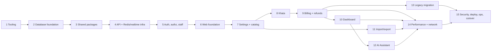

# IMPLEMENTATION_PLAN.md — Phased Implementation Plan

**Status:** Implementation in progress (owner instruction 2026-10-29). See the ledger in §4.
**Last updated:** 2026-10-28

Test ids (FIN, PAG, SEC, RT, RED, NET, E2E, MIG, ARCH, STG) are defined in [TESTING.md](TESTING.md). Check
commands are in [CODING_STANDARDS.md §8](CODING_STANDARDS.md). Feature ids come from [FEATURES.md](FEATURES.md).

---

## 1. Rules for every phase

1. **Vertical slices:** each feature phase delivers migration, API, events, UI and tests together, so it is
   testable on its own.
2. **Gate to finish a phase:** `pnpm verify` green; `pnpm test:integration` green; the phase's e2e specs green;
   the manual audits (CODING_STANDARDS.md §9) recorded in the ledger (§4); affected docs updated.
3. **Report to the owner** after each phase: what was built, test output summary, deviations from the docs,
   new open questions. The owner commits. Claude does not commit, push or deploy unless asked.
4. A phase that needs an unanswered business question uses the documented default and lists it in the report.
5. No placeholder modules: a module, table or screen is created only in the phase that implements it.

---

## 2. Phase overview and dependencies

The brief's order is adjusted for dependencies. Shared contracts and domain maths (Phase 3) come before the
API foundation because error codes, limits and money rules are needed there. Redis and realtime
infrastructure are in Phase 4, before any feature (D-26). Frontend work is split into a foundation (Phase 6)
plus a vertical slice per feature, instead of one late "frontend integration" phase.

---

## 3. Phases

### Phase 1 — Repository tooling and shared configuration
- **Prerequisites:** owner approval; the owner runs `git init` and creates the GitHub repository; versions in
  DECISIONS.md §1 verified and pinned.
- **Features:** none (infrastructure).
- **Steps:** (1) root `package.json` (`packageManager`, `engines`, scripts from CODING_STANDARDS.md §8),
  `pnpm-workspace.yaml`, `turbo.json`, `.npmrc`, `.nvmrc`, `.editorconfig`, `.gitattributes`, `.gitignore`;
  (2) `packages/config-typescript`, `packages/config-eslint` (incl. no-polling, money and SQL restrictions),
  Prettier; (3) `.dependency-cruiser.cjs`, `.jscpd.json`, `.gitleaks.toml`; (4) `scripts/check-*.ts`,
  `file-size.config.json`, `pagination-allowlist.json`, each with fixture-based tests; (5)
  `infra/docker-compose.yml`, `infra/redis/redis.conf`, `.env.example`; (6) `.github/workflows/ci.yml` (quality
  job), `CODEOWNERS`, PR template, `renovate.json`, `vitest.workspace.ts`.
- **Acceptance:** `pnpm install` is clean; `docker compose up` gives healthy Postgres and Redis; each check
  script **fails** on its violating fixture (e.g. a 201-line file, a `pollInterval`, a cycle) and passes on a
  clean tree; the CI quality job passes on a PR.
- **Compliance:** scripts themselves ≤ 200 lines and duplicate-free.
- **Depends on:** —

### Phase 2 — Database foundation and migrations
- **Prerequisites:** P1.
- **Features:** groundwork for F-01, F-31, F-30 (tables only).
- **Steps:** (1) `packages/database` with `prisma.config.ts`, multi-file schema `base.prisma`, `auth.prisma`,
  `system.prisma` (users, sessions, shop_settings, outbox_events, audit_logs); (2) migrations: extensions
  (`pg_trgm`, `citext`), auth, system, with checks and indexes from DATABASE.md §4; seed row `shop_settings`;
  (3) `src/index.ts` client export; `seed/seed-dev.ts`; (4) `db:*` scripts with the localhost guard; (5) CI step:
  apply all migrations to an empty DB, then `prisma migrate diff` must report no drift.
- **Acceptance:** migrations reproduce from empty locally and in CI; the guard refuses a non-localhost URL
  (test); each migration ≤ 200 lines.
- **Tests:** migration reproducibility; constraint tests for the users/sessions/settings checks.
- **Depends on:** P1.

### Phase 3 — Shared packages: contracts, domain, validation
- **Prerequisites:** P1.
- **Features:** the calculation core for F-20–F-22, F-16, F-33; permissions for F-04; formatting used everywhere.
- **Steps:** (1) `@pos/contracts`: `errors.ts`, `limits.ts`, `permissions.ts`, `events.ts`, `enums.ts`;
  (2) `@pos/domain`: money, allocation, `calculateBill`, `calculateRefund`, units, low-stock rule, business
  date, bill-number format, formatting (money, date, phone); (3) `@pos/validation`: `common`, `pagination`,
  `auth`, `staff`, `settings` schemas (feature schemas are added in their phases); (4) `tsup` builds and package
  `exports`.
- **Acceptance:** FIN-01–FIN-05, FIN-07 and the refund maths of FIN-15 pass as unit tests; domain coverage
  ≥ 95 %; packages consumable from both CJS and ESM (smoke test).
- **Compliance:** `domain-is-pure`, `contracts-is-leaf`, `validation-deps` pass.
- **Depends on:** P1.

### Phase 4 — API foundation with Redis and realtime infrastructure
- **Prerequisites:** P2, P3.
- **Features:** none user-facing. `serverInfo { version businessDate }` (`@Public`) gives the schema its first
  real query and feeds the terminal header date.
- **Steps:** (1) `main.ts`, `app.module.ts`, `config/*` (Zod env); (2) `common/*`: errors and formatter, Prisma
  error mapper, pagination primitives, scalars, GraphQL module (limits, CSRF, introspection off in production),
  Zod pipe, logging with redaction, clock/sleep, idempotency helpers, test-only failpoints;
  (3) `infrastructure/prisma` (`UnitOfWork`, retry, timeouts); (4) `infrastructure/redis` (four clients,
  lifecycle events), `cache` (generation keys, `NX`, single-flight, jitter), `rate-limit` (Redis storage +
  memory fallback), `realtime` (outbox repository/service/publisher/after-commit hook, drain triggers,
  prune-on-write, `RedisPubSub`, channels), `queue` (BullMQ module, drain), `crypto`, `metrics`;
  (5) `modules/health`; (6) `cli/emit-schema.ts`; (7) Dockerfile, `railway.json`; (8) `test/support`
  (containers, app factory with two instances).
- **Acceptance:** boots only with valid env; `/health/live` and `/health/ready` behave per API.md §9; outbox
  round-trip using a test-only event registered from `test/support` (not production code).
- **Tests:** RED-03, RED-04, RED-06, RED-09, RED-10 (on `serverInfo`-adjacent cache fixtures); RT-04 and RT-05 at
  infrastructure level; `UnitOfWork` retry and rollback tests.
- **Compliance:** `api-core-no-modules`; ARCH-01 initial graph; schema drift check active.
- **Depends on:** P2, P3.

### Phase 5 — Authentication, authorization and staff
- **Prerequisites:** P4.
- **Features:** F-01, F-03, F-04, F-31; F-02 added later with a shared sign-up key (D-10); session revocation; WebSocket auth;
  `shopEvents` subscription endpoint; audit writer.
- **Steps:** (1) `modules/audit` (writer, actions list); (2) `modules/auth` (login, logout, `me`, change
  password, session service with cache and tombstones, cookie); (3) guards and decorators in `common/auth`;
  (4) `modules/staff` (CRUD, status, reset, last-admin guard); (5) `modules/realtime` (`ShopEvent` interface,
  `shopEvents`, `ws-connection.service.ts`, audience channels, `session.revoked` handling, resync notifier);
  (6) `cli/create-admin.ts`.
- **Acceptance:** an admin can be bootstrapped, log in, create a cashier and disable them, with sockets closed;
  the authz matrix covers every operation that exists.
- **Tests:** SEC-01, 02, 04–10, 13, 15; RT-02, RT-09; RED-05, RED-07.
- **Depends on:** P4.

### Phase 6 — Web foundation
- **Prerequisites:** P5.
- **Features:** F-05 (theme), login UI, role routing, admin shell, terminal shell, change password, staff UI
  (F-31), connection banner (F-37 UI part).
- **Steps:** (1) Next.js app config, Tailwind, shadcn primitives needed now, `next.config.ts` headers;
  (2) `codegen.ts`, fragments folder; (3) `lib/apollo` (client, links, error link, type policies, pagination
  policies), `lib/realtime` (client, backoff, dedupe, router, reconcile, `session-revoked` handling),
  `lib/errors`, `lib/timing`, `lib/ids`, `lib/storage`, `lib/env`; (4) providers; (5) routes: login, `(app)`
  layout with `ViewerGate`, `(admin)` layout with sidebar, `terminal` layout shell; (6) `components/data`,
  `feedback`, `forms`, `layout`; (7) `features/auth`, `features/staff`.
- **Acceptance:** login, logout and role redirects work against the local API; banner states render from
  simulated socket events; zero requests while idle on the admin shell.
- **Tests:** E2E-01, E2E-11 (routes so far); RT-06, RT-07, RT-08, RT-11 (client units); NET-04 (shell); bundle
  baseline recorded.
- **Compliance:** `web-not-to-server`, `web-shared-no-features`; no `setTimeout` outside `lib/timing`.
- **Depends on:** P5.

### Phase 7 — Settings and catalog (categories, products, inventory, low stock)
- **Prerequisites:** P6.
- **Features:** F-08, F-09, F-10, F-12, F-13 (list and badge), F-32; shop profile and default GST (Q26);
  P-02 stock history (if the owner confirms).
- **Steps:** (1) `catalog.prisma` and migrations (categories, products, stock_movements with indexes);
  (2) validation schemas (category, product, inventory); (3) `modules/settings` (profile, cached) and
  `modules/catalog` (categories, products, inventory, low stock, events, cache invalidation);
  (4) `features/catalog`, `features/settings` (profile), sidebar badge with live updates.
- **Acceptance:** admin manages the full catalogue; clone per barcode; restock and adjust with reasons; low-stock
  list and badge update live across browsers.
- **Tests:** FIN-23; PAG-01–09 for products, categories, low stock, stock movements; RT-01 (catalog events);
  RED-03, RED-04 (categories, settings); NET-01, NET-02 (product operations); E2E-05; E2E-10 (products).
- **Depends on:** P6.

### Phase 8 — Customer and vendor khata
- **Prerequisites:** P7.
- **Features:** F-25, F-26, F-28 (khata and vendor modals), F-35 (ledger archive window), D-12 archiving.
- **Steps:** (1) `khata.prisma` and migrations; (2) schemas; (3) `modules/customers`, `modules/vendors` (ledger
  services exported for sales); (4) `components/ledger`, `features/customers`, `features/vendors`, terminal
  `KhataModal` and vendor modal.
- **Acceptance:** add customer and vendor, manual credit, payments, purchases; running balances correct;
  archive blocked with a balance (Q33 default).
- **Tests:** FIN-21; PAG-08 and connection coverage; RT-01 (balance events); SEC-02 (cashier allowed per D-11).
- **Depends on:** P7.

### Phase 9 — Billing, receipts, order history and refunds
- **Prerequisites:** P8.
- **Features:** F-15, F-16, F-18–F-23, F-28 (refund modal), F-33, F-34, F-35 (orders archive), F-37.
- **Steps:** (1) `sales.prisma` and migrations (counters, orders, lines, refunds, refund lines, checks);
  (2) sale and refund schemas; (3) `modules/sales` (`createSale`, `saleStatus`, orders, `order`,
  `orderReceipt`, `refundOrder`, events); (4) `features/terminal` (grid, search, scan, cart, payment, Udhaar
  picker, pending sale, receipt print CSS); (5) `features/orders` (history, refund dialog, terminal refund modal).
- **Acceptance:** full counter workflow on two browsers with live stock; idempotent retries; receipts print at
  80 mm; refunds restock and credit khata.
- **Tests:** FIN-01–FIN-20, FIN-22, FIN-24 (integration); RED-01, RED-02, RED-11; RT-03, RT-04; E2E-02, 03, 04, 06,
  07, 08, 09; NET-03, NET-07.
- **Depends on:** P8.

### Phase 10 — Dashboard and reporting
- **Prerequisites:** P9.
- **Features:** F-06, F-07 (expiry tile removed, D-23).
- **Steps:** (1) TypedSQL files in `packages/database/prisma/sql`; (2) `modules/reporting` (`dashboard` with
  field-level aggregates); (3) `features/dashboard` (`DashboardLive` + `DashboardHistory`, lazy charts).
- **Acceptance:** every tile and chart matches hand-computed fixtures (refunds by refund date, Q28 default;
  Monday week start; Asia/Karachi dates); live update after sales.
- **Tests:** aggregate fixture tests; RT-08; E2E-13; NET-01 (dashboard budgets).
- **Depends on:** P9.

### Phase 11 — Product import and exports (BullMQ)
- **Prerequisites:** P7 (catalog).
- **Features:** F-11, F-13 (exports).
- **Steps:** (0) `infrastructure/queue` (BullMQ module, queue names, `queue.drain.ts` on startup and Redis
  `ready`), deferred from Phase 4 to its first consumer; (1) import tables and migration; (2) import row schema; (3) `modules/catalog-io` (upload controller,
  staging, processor, template, exports), `infrastructure/files`; (4) `features/catalog-io` (import dialog,
  progress, export menu).
- **Acceptance:** 5,000-row import completes with progress and an error report; re-upload is idempotent; exports
  stream with bounded memory.
- **Tests:** RED-08; SEC-14; E2E-12; export memory test (10,000 products under a fixed heap budget).
- **Depends on:** P7.

### Phase 12 — AI Assistant
- **Prerequisites:** P10 (reporting queries); U-05 model chosen.
- **Features:** F-29, F-30 (Groq key management).
- **Steps:** (1) `infrastructure/ai/groq.client.ts` and `infrastructure/crypto/secret-box.ts` (AES-256-GCM,
  deferred from Phase 4 to its first consumer); (2) `settings` AI key service (encrypt, last4, clear);
  (3) `modules/ai-assistant` (six mutations, prompt builder, chat tools, result cache, rate limit);
  (4) `features/ai`, settings `AiKeyForm`; Groq stub for e2e.
- **Acceptance:** all six features work in three languages against the stub; no PII in prompts; key never
  returned.
- **Tests:** E2E-14; SEC-11, SEC-12 (prompt capture); AI rate limit and cache tests; tool-argument bounds.
- **Depends on:** P10.

### Phase 13 — Legacy data migration tool
- **Prerequisites:** P9 (all target tables); **Q27**: the owner shares the old schema (names only).
- **Features:** F-36.
- **Steps:** (1) `schema-map.ts` from the owner's schema; (2) fixture legacy DB for tests; (3) steps per entity
  with `legacy_id`; (4) dry-run report (bounded console output plus CSV); (5) verification.
- **Acceptance:** MIG-01–MIG-05 pass; the owner can run a dry-run on their machine following the runbook draft.
- **Depends on:** P9.

### Phase 14 — Performance and network verification
- **Prerequisites:** P9–P12.
- **Features:** the budgets in NETWORK_OPTIMIZATION.md.
- **Steps:** (1) `tools/perf` dataset, scenarios, meters, budget check; (2) e2e network specs;
  (3) `network-budgets.yml`; (4) run, fix regressions, tune budgets with evidence; (5) fill NETWORK_OPTIMIZATION.md §9.
- **Acceptance:** NET-01–NET-07 pass; simulated monthly Neon transfer at 1,500 bills is below the hard ceiling,
  with the measured figure recorded.
- **Depends on:** P9, P10, P11, P12.

### Phase 15 — Security hardening, deployment, operations and cutover
- **Prerequisites:** P13, P14; U-01–U-04, U-06, U-07 resolved by the owner.
- **Features:** production readiness; F-36 executed.
- **Steps:** (1) staging and production per DEPLOYMENT.md; (2) Sentry, uptime, metrics, alert test fires;
  (3) `backup.yml` and a restore drill; (4) runbooks: incident, restore, rotate-secrets, cutover, counter PC
  setup; (5) security review (OWASP ASVS level 1 checklist, dependency audit, header scan); (6) migration
  rehearsal on staging, then cutover (DEPLOYMENT.md §11).
- **Acceptance:** STG-01–STG-04 pass; restore drill recorded; alerts verified; owner sign-off on the rehearsal
  before production cutover.
- **Depends on:** P13, P14.

---

## 4. Progress ledger (updated by implementing sessions only)

| Phase | Status | Started | Completed | `verify` / integration / e2e | Manual audits | Notes |
|---|---|---|---|---|---|---|
| 1 Tooling | Done | 2026-10-29 | 2026-10-29 | verify gates all PASS; scripts tests 22/22; secrets PASS (gitleaks 8.30.1); integration/e2e: none yet | Violation probes: ESLint caught polling/timers/unsafe SQL/any/ts-ignore; depcruise caught a cycle; jscpd caught a clone | Node 24 portable (system Node 25); WSL Postgres 17 + Redis 8 instead of Docker; see DECISIONS §1 |
| 2 Database foundation | Done | 2026-10-29 | 2026-10-29 | verify gates PASS; database integration 9/9 (migrations apply to empty DB, no drift, constraints reject bad rows); testkit unit 5/5; secrets PASS | Drift probe: Prisma keeps hand-written CHECKs and partial indexes (empty probe migration, deleted) | 2026-11-01: fresh Neon initialized with 7 migrations; status, schema diff and pooled index check PASS. Integration and E2E tests for this change not rerun (local services unavailable). Dev seed deferred to Phase 7; `@pos/testkit` added for shared test DB helpers |
| 3 Shared packages | Done | 2026-10-29 | 2026-10-29 | verify gates PASS; domain 50/50 tests, coverage 100 % (statements, branches, functions, lines); contracts 18/18; validation 17/17; database enum parity (ARCH-02) PASS; integration 9/9 | FIN-01–FIN-07 and refund maths (FIN-15 sequence) covered as unit tests | Feature schemas (product, sale, khata, …) are added in their feature phases |
| 4 API + Redis/realtime infra | Done | 2026-10-29 | 2026-10-29 | `pnpm verify` PASS (format, lint, typecheck, file-size, duplication 0 clones, deps, no-polling, pagination + prisma-take, unit tests, build, schema drift); API unit 100/100 incl. ARCH-01 module graph; API integration 28/28 on real PostgreSQL 17 + Redis 8 (3 consecutive runs; RED-03/04/06/07/09/10, RT-03/04/05 infra, UnitOfWork commit/rollback/retry incl. a real 40P01 deadlock, outbox round trip, CSRF, depth limit, introspection off in production); database integration 9/9; testkit 10/10; scripts 23/23; domain 51/51 (100 %); secrets PASS | Image layout replayed without Docker: turbo prune → frozen install → build → prod install → boot (`NODE_ENV=production`) → `migrate deploy` on a throwaway DB, all PASS. ARCH-01 violation probe (undocumented `health → server-info` import) was caught, then reverted. Docker build itself: BLOCKED locally (no Docker), first built in CI/Railway | `queue` → Phase 11 and `crypto` → Phase 12 (first consumers). Phase 5 must add `@Public()` to `serverInfo` when the decorators exist. Fixed on the way: invalidation-INCR failure fallback (SYSTEM_DESIGN §6.5), Pub/Sub subscribe rollback, Percent rule single-sourced in `@pos/domain`, `dotenv` dropped (ADR-032) |
| 5 Auth, authz, staff | Done | 2026-10-30 | 2026-10-31 | `pnpm verify` PASS; API unit 100/100; API integration 91/91 in 18 files (incl. realtime-ws: SEC-08, RT-01/02/05/09, SEC-05 one instance); database integration 13/13; secrets PASS | SEC-01 violation probe caught, then reverted. `create-admin` CLI bootstraps the first admin | Realtime module (`shopEvents`, WS admission, revoked-session close, resync) finished 2026-10-31; per-socket subscription cap fixed to count graphql-ws reservations (ADR-036). 2026-11-01: secret-protected F-02 added; integration and E2E verification pending. Upstash TLS PING and read-only Lua pass after owner-approved 1-second cache timeout; full provider compatibility, stalled-Redis integration and E2E remain unverified |
| 6 Web foundation | Done | 2026-10-30 | 2026-11-01 | web unit 18/18 (RT-06, RT-07, RT-08, RT-11); e2e incl. E2E-07 and the offline banner; NET-04 (`network.spec.ts`: 0 API requests in 2 idle minutes on terminal, overview, low stock, orders; only ping/pong on the socket); bundle baseline (NET-05: first-load JS 363–381 KB compressed, repeat visits 4.5–8.9 KB) | Screens checked visually (login, admin shell, catalogue, settings, dialogs) | Sidebar links no longer prefetch every route (ADR-042) |
| 7 Settings + catalog | Done | 2026-10-30 | 2026-10-31 | `pnpm verify` PASS; API integration 91/91 (catalog, settings, events, NET-01/NET-02/PAG-07/PAG-09, SEC-09); database 13/13; web unit 18/18; e2e 19/19 incl. E2E-05, E2E-10; secrets PASS | NET-01 measured: barcode lookup 495 B, 50 admin rows 24,739 B (budget 25 KB); last 3 full integration runs green; earlier runs under heavy machine load hit harness/Redis timeouts in older specs (see F-08 Limitations) | F-08/F-09/F-10/F-12/F-32 COMPLETE; F-13 export → Phase 11; P-02 awaits owner; dev seed (`pnpm db:seed`) added; query cost model refined (ADR-035) |
| 8 Khata | Done | 2026-10-31 | 2026-10-31 | Verified with Phase 9 (same gate run): `pnpm verify` PASS; khata integration 8/8 (FIN-21, PAG-08, RT-01), database khata constraints 4/4, e2e khata 3/3 + E2E-03; secrets PASS | Customers and vendors share one posting engine (ADR-037); events carry ids and two-decimal money only (no names or phones) | F-25, F-26 COMPLETE; F-28 and F-35 completed with Phase 9. Ledger "new entries" banner replaced by a coalesced refetch (API.md §7.2) |
| 9 Billing + refunds | Done | 2026-10-31 | 2026-10-31 | `pnpm verify` PASS (608 files ≤ 200, 0 clones, 0 dependency violations, no-polling, pagination, schema drift); unit: API 100, web 35, domain 59 (100 %), validation 34; integration: database 13/13, API 124 in 26 files (2 files hit the known start-up timeout in the full run and passed on re-run, see F-22); e2e 29/29; secrets PASS | FIN-01–FIN-24 incl. FIN-20 failpoint rollback and FIN-22 (500 random operations, DATABASE.md §12 checks all 0); RED-01, RED-11; NET-03 18.8 KB per scan-based bill (was 29.5 KB before batching stock writes); NET-07 = 4 requests; E2E-02/03/04/06/08/09 | Payment as a dialog, shared receipt components, pending-sale retries, `online` recovery (ADR-038). `cli:verify-integrity` added. RT-03/RT-04 with real sales across two instances → Phase 14; real 80 mm printer check → owner before go-live |
| 10 Dashboard | Done | 2026-10-31 | 2026-11-01 | Verified with Phase 11 (same gate run): `pnpm verify` PASS; reporting integration 3/3 (hand-computed figures, ≤ 5 statements and ≤ 3 KB live, ≤ 8 KB history); web dashboard unit tests; E2E-13; secrets PASS | Every figure is one SQL aggregate (Q18 weeks from Monday, Q28 refunds on their own date, Q30 tax); charts follow the validated palette with a screen-reader table; live tiles refetch on events, history on Refresh (ADR-039) | F-06, F-07 COMPLETE. Admins land on `/dashboard` |
| 11 Import/export | Done | 2026-10-31 | 2026-11-01 | `pnpm verify` PASS (681 files ≤ 200, 0 clones, 0 dependency violations, no-polling, pagination, prisma-take, schema drift); unit: API 100, web 40, domain 59, validation 38; integration: database 20/20, API 132/132 in 30 files (2 files hit the harness start-up flake and passed on re-run; root cause fixed, see F-11); e2e 31/31; secrets PASS | SEC-14 (size, magic bytes, row cap, CSRF, cashier), RED-08 (upload while Redis is down), 10,000-product streamed export in bounded statements, formula escaping | BullMQ via `QueueRuntime` (starts only when Redis is ready, 5 s shutdown cap); import rate limit falls back to memory (ADR-040). F-11 legacy header support added 2026-11-01; unit tests pass, integration and user CSV verification pending. F-13 COMPLETE. Two moderate transitive exceljs advisories accepted (ADR-040) |
| 12 AI Assistant | Done | 2026-11-01 | 2026-11-01 | `pnpm verify` PASS (737 files ≤ 200, 0 clones, 0 dependency violations, no-polling, pagination, prisma-take, schema drift); unit: API 108, web 45, validation 43, domain 59; integration: database 21/21, API 141/141 in 32 files in one run (no start-up flakes after the harness fix); e2e 32/32 incl. E2E-14; secrets PASS | SEC-03 (key fields), SEC-11 (responses, ciphertext, audit, outbox, e2e API log file), SEC-12 (prompts captured by the Groq stub: no customer names, phones or ids), AI rate limit (30/h, fails closed with Redis down), 5xx retry and 401 mapping, cache, tool-argument bounds, 3-round tool cap | Model `openai/gpt-oss-120b` (U-05 default, `GROQ_MODEL`), ADR-041; Q38 defaults recorded. Fixed on the way: `ShopSettings.updatedAt` and `AiResult.generatedAt` (DateTime needs a Date), empty report dates, ids in prompts. Real-Groq answer quality to be checked by the owner with the shop key |
| 13 Legacy migration | Blocked | — | — | — | — | Needs the old schema (Q27): `docs/runbooks/cutover.md` §1 has the two read-only queries for the owner to run (checked on the local database). The tool is written once the schema is known. Add `test:integration` back to `tools/legacy-migration/package.json` (`vitest run --config vitest.integration.config.ts`) with MIG-01–05: it was removed on 2026-11-07 because, with no tests to run, it could only fail CI |
| 14 Performance + network | Done | 2026-11-01 | 2026-11-01 | `tools/perf` day workload (NET-06): all 17 budgets PASS, **63.6–63.8 MB/month** database transfer at 1,500 bills (target 300 MB, ceiling 1 GB), 43.3 KB per bill, 1.5 KB per idle hour; `network.spec.ts` NET-04 + NET-05 PASS; perf unit 4/4 | Per-resource byte breakdown read for each route | Fixed: route prefetch (481 → 363–381 KB first-load JS, 51–55 KB → 4.5–8.9 KB repeat visits), order-history rows 22.3 → 17.3 KB. Budget tuned with evidence: first-load JS 300 → 410 KB (ADR-042). Nightly `network-budgets.yml` |
| 15 Deploy, ops, cutover | Local part done; deployment blocked | 2026-11-01 | — | SEC-02 matrix (every operation × 3 callers) PASS; key rotation 3/3; sign-everyone-out 1/1; metrics; security headers e2e 2/2; `pnpm audit` 0 high/critical | Security review: authorization matrix, CORS tightened (SEC-07), headers, dependency audit, secrets scan; runbooks written (ADR-043) | Waiting on the owner: U-01–U-04, U-06, U-07 (hosts, domain, Neon plan, backup bucket, error/uptime tools) for deploy, STG-01–04, backups, restore drill and alerts; Sentry wiring waits for U-07. 2026-11-07: CI first ran on the upstream repository (ADR-044) and exposed formatting, lint, file-size and duplication failures, a package with no tests, Turbo hiding the `TEST_*` variables from integration tests, a lint script that needed the generated Prisma client, `DashboardLive` at 6 statements against its budget of 5 (now 4), and the random-activity test selling products the server refuses at 0 or below. All were fixed without weakening a check, and D-16 now records that block |

Status values: `Not started` → `In progress (step n)` → `Gate pending` → `Done`. A phase becomes `Done` only
with its gate results filled in.

---

## 5. Resuming after an interrupted session

1. Read `CLAUDE.md`, then this ledger, then the current phase's section above.
2. Inspect the working tree (`git status`, recent `git log`) for half-finished work. If it is not a git
   repository yet, list recently modified files.
3. Run `pnpm verify` (and `pnpm test:integration` if Docker is available) to establish the real state. Do not
   trust the ledger over the test results.
4. Continue from the first step of the phase whose files or tests are missing or failing. Do not restart
   completed steps.
5. If code and documents disagree, stop and reconcile them in the same change. Never silently follow one.
6. Update the ledger row (status, step, date, gate results) before ending the session.
