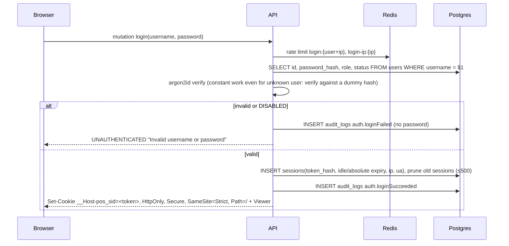
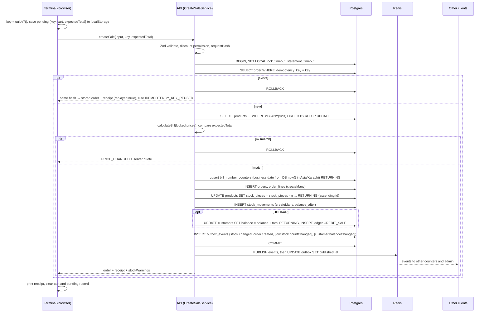
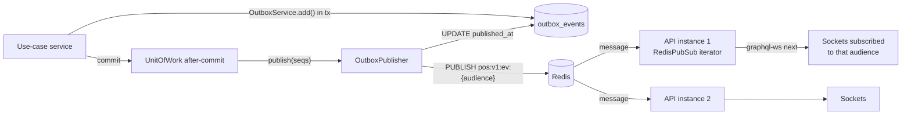
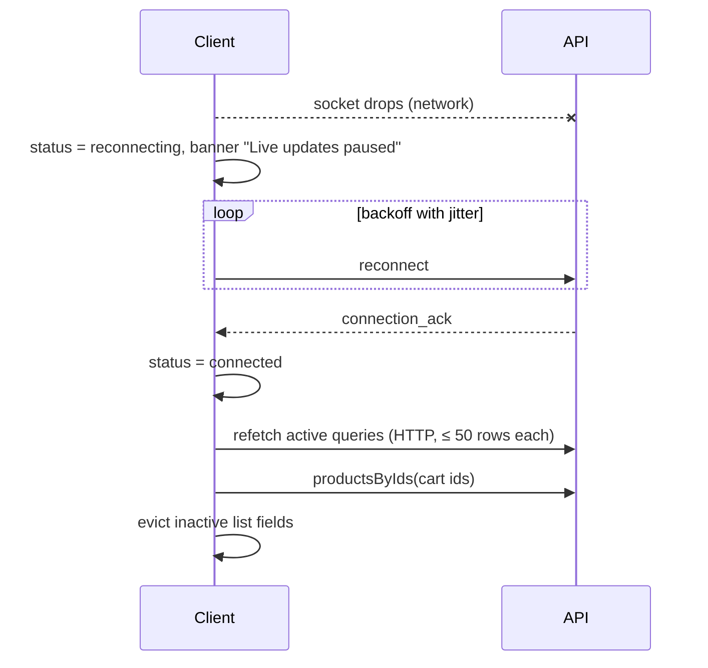

# SYSTEM_DESIGN.md — Detailed System Behaviour

**Status:** Proposed, awaiting owner review (design stage). Nothing is implemented.
**Last updated:** 2026-10-28
**Related:** [ARCHITECTURE.md](ARCHITECTURE.md) · [API.md](API.md) · [DATABASE.md](DATABASE.md) ·
[NETWORK_OPTIMIZATION.md](NETWORK_OPTIMIZATION.md) · [DECISIONS.md](DECISIONS.md)

Business rules referenced as `BR-xx`, `D-xx`, `A-xx`, `Q-xx` are defined in [FEATURES.md](FEATURES.md).

---

## 1. Request lifecycle summary

| Step | HTTP query/mutation | WebSocket subscription |
|---|---|---|
| Transport | `POST /graphql`, cookie, JSON | Upgrade on `/graphql`, cookie, `graphql-transport-ws` |
| Edge | TLS at Railway edge | Same |
| Security | helmet, CORS allowlist, CSRF preflight rule, body limit | `Origin` check, connection limit |
| Identity | `SessionGuard` → principal (§2.2) | `onConnect` → principal stored in socket context |
| Authorization | `PermissionGuard` + field guards | Channel selection by role (§5.3) |
| Throttling | `ThrottlerGuard` buckets (API.md §8) | `ws-connect` bucket |
| Validation | GraphQL types, then `ZodValidationPipe` | Subscription has no arguments |
| Execution | Resolver → application service → `UnitOfWork.run()` (§3.3) | Async iterator over Redis channels |
| After commit | Outbox publish (§5.2) | — |
| Logging | pino line: requestId, userId, operationName, ms, outcome | connect/disconnect lines with duration |

---

## 2. Authentication and authorization

### 2.1 Login

### 2.2 Session resolution on every request

1. Read the cookie and compute `tokenHash = sha256(token)`.
2. `GET pos:v1:sess:{tokenHash}` (cache client, 1-second timeout).
   - `"REVOKED"` tombstone → `UNAUTHENTICATED`.
   - JSON principal and not expired → use it.
   - Miss or Redis error → step 3.
3. `SELECT` the session joined to the user (`revoked_at IS NULL`, both expiries > `now()`, user `ACTIVE`). On
   success, `SET pos:v1:sess:{tokenHash} <principal> EX 300 NX`. `NX` means a stale fill can never
   overwrite a revocation tombstone.
4. **Touch:** if `last_seen_at` is older than 15 minutes, `UPDATE sessions SET last_seen_at = now(),
   idle_expires_at = now() + 12h` (at most 4 writes per hour per session).
5. The principal `{ sessionId, userId, role, permissions }` goes into the request context.

### 2.3 Revocation

| Trigger | Sessions revoked | Extra |
|---|---|---|
| `logout` | Current | Cookie cleared |
| `changePassword` | All of the user's sessions **except** the current one | — |
| `setStaffUserStatus(DISABLED)`, `resetStaffPassword`, role change | All of that user's sessions | Last-admin guard |

Procedure, all inside the use-case transaction: `UPDATE sessions SET revoked_at = now(), revoke_reason = …
WHERE … RETURNING id, token_hash`. Then add an outbox `session.revoked { sessionIds }` on `user:{id}`. After
commit, write `SET pos:v1:sess:{hash} "REVOKED" EX 300` for each hash and publish. Every API instance receives
`session.revoked` and closes matching sockets with code `4401`. If Redis is down, revocation still holds:
the cache fill is skipped and the Postgres lookup rejects revoked sessions. The only window is a principal
cached **before** revocation, at most 300 s, and the tombstone closes it as soon as Redis is reachable.

### 2.4 Authorization

- One access policy on every resolver and controller method: `@RequirePermission(p)`, `@Authenticated()`
  (any signed-in user) or `@Public()` (login, serverInfo, health). The global `AccessGuard`
  (`common/auth/access.guard.ts`) resolves the session through the auth module's `PRINCIPAL_RESOLVER`, checks
  `ROLE_PERMISSIONS[role]` from `@pos/contracts`, and refuses handlers without a policy.
- **Field-level:** `Product.costPrice` needs `catalog:write`; `ShopSettings.aiKeyConfigured`/`aiKeyLast4`
  need `settings:write`. A cashier requesting them gets `FORBIDDEN` for that field.
- **Argument-level:** a `createSale` discount other than `NONE`, overall or on an item, needs `sales:discount`.
- The web UI hides actions with `useCan()`, which is only a convenience. The API always decides.

### 2.5 WebSocket authentication

`onConnect(ctx)` (in `modules/realtime/application/ws-connection.service.ts`):
1. Reject if `Origin ≠ WEB_ORIGIN` (`4403`).
2. Throttle `ws-connect` per IP (`4429`).
3. Resolve the cookie exactly as §2.2; failure → `4401`.
4. Enforce at most 10 sockets per user on this instance (`4429`).
5. Store `{ principal, connectedAt }` in `ctx.extra` and register the socket in the instance-local
   `sessionId → Set<socket>` map, which `session.revoked` uses.

`onSubscribe` re-checks that the session is not revoked (cache lookup) and caps subscriptions per socket at 3.
`onDisconnect`/`onClose` remove the socket from all maps (§5.7).

---

## 3. Billing

### 3.1 Cart and preview (client)

- `CartProvider` (`features/terminal/state`) holds `lines: { productId, unit, quantity, discount? }[]`, the
  overall discount and Bill GST input, payment method and customer. Prices are **not** stored in the cart; the
  preview reads current product fields from the Apollo cache, which events keep current. A product deleted
  while in the cart leaves it (D-28).
- The product picker shows the same server page as cards or as up to three lists side by side, where a tap on
  a row adds it (F-38); the choice is remembered per
  browser in `pos:terminal:product-view`.
- `useCartPreview()` calls `calculateBill()` from `@pos/domain`, the same function the API uses (ADR-013).
- Barcode: the search input keeps focus. On `Enter`, `productByBarcode(text)` runs; a match adds one unit
  (Q22 default); no match falls back to name search.
- Stock warning (D-16): when `quantity × piecesPerUnit > stockPieces` (cached), the line shows a warning. The
  sale is still allowed, unless the product is already at 0 or below: the server refuses that sale.
- Persistence: the cart is saved to `localStorage` key `pos:cart:{userId}` on every change and restored on
  load. It is cleared only after a **confirmed** sale.

### 3.2 Calculation specification (`@pos/domain`)

All arithmetic uses `Decimal` with `ROUND_HALF_UP` to 2 places (A-02). Input prices come from **locked**
product rows on the server.

`calculateBill(lines, discount, billGst)`:
1. `lineGross_i = unitPrice_i × quantity_i`, where unit price is `sale_price` for `PIECE` and `box_price` for
   `BOX` (D-17).
2. `subtotal = Σ lineGross_i`.
3. `itemDiscount_i` (D-27) = `0` (NONE) | `amount` (FLAT; must be ≤ `lineGross_i`) | `round2(lineGross_i × percent / 100)`
   (PERCENT). `left_i = lineGross_i − itemDiscount_i`; `itemDiscountTotal = Σ itemDiscount_i`.
4. `billDiscountTotal` = `0` (NONE) | `amount` (FLAT; must be ≤ `Σ left_i`) | `round2(Σ left_i × percent / 100)` (PERCENT).
   Allocate it to lines in proportion to `left_i` using the largest-remainder method in paisa (ties go to the
   lower line number), so the shares sum to it exactly (A-01). `lineDiscount_i = itemDiscount_i + share_i`, and
   `discountTotal = itemDiscountTotal + billDiscountTotal = Σ lineDiscount_i`.
5. `lineNet_i = lineGross_i − lineDiscount_i`.
6. `lineTax_i = round2(lineNet_i × taxRate_i / 100)`; `productTaxTotal = Σ lineTax_i` (D-07, D-08).
7. `billGstAmount = applied ? round2((Σ lineNet_i + productTaxTotal) × rate / 100) : 0` (D-25).
8. `total = subtotal − discountTotal + productTaxTotal + billGstAmount` (D-09: no rupee rounding).

`calculateRefund(order, requested, previousRefunds)` (A-06, proposed):
1. For each requested line with `k` units (`1 ≤ k ≤ quantity − refundedQuantity`):
   - If `k` refunds the **last** remaining units: `lineAmount = (lineNet + lineTax) − Σ earlier refund amounts
     of that line` (exact remainder).
   - Otherwise: `lineAmount = round2((lineNet + lineTax) × k / quantity)`.
2. Bill GST share: if this refund completes the order, `billGstAmount − Σ earlier shares`; otherwise
   `round2(billGstAmount × Σ lineAmount / (Σ lineNet + productTaxTotal))`.
3. `amount = Σ lineAmount + gstShare`. A full refund therefore always equals `total` exactly.

Worked examples (TESTING.md FIN-01–FIN-05): `#44` 240.00 + 18 % GST = 283.20 · D-25 1,000 + 10 % product tax
+ 18 % GST = 1,298.00 · D-08 1,000 − 10 % + 18 % GST = 1,062.00.

### 3.3 `createSale`

Rules:
- `UnitOfWork.run(fn)` (`infrastructure/prisma/unit-of-work.ts`) wraps `TransactionHost.withTransaction`,
  sets the local timeouts, retries `40001`/`40P01` up to 3 times, and publishes the outbox events collected in
  CLS **after** commit (ADR-009, ADR-029).
- **Time comes from the database:** `business_date` is `(now() AT TIME ZONE 'Asia/Karachi')::date`, returned
  by the counter upsert. Bills around midnight and instances with skewed clocks still number correctly.
- Archived or missing products → `NOT_FOUND` with ids. `BOX` without `box_price` → `BAD_USER_INPUT`.
- Threshold crossings (stock was above the threshold and is now at or below it, or the reverse) add
  `lowStock.countChanged { crossedProductIds }` to the outbox.

### 3.4 Network interruption and retries

| Situation | Behaviour |
|---|---|
| Request fails with a network error or 30 s timeout (`AbortSignal.timeout`) | Banner "Confirming sale…". The **same** mutation and key are re-sent up to 5 times, after a jittered back-off of about 1, 2, 4, 8, 16 s and, when offline, after the browser fires `online` (event-triggered retries of one mutation, not polling; `hooks/sale-sender.ts`) |
| Still unconfirmed | "Sale status unknown" with **Check status**, which calls `saleStatus(idempotencyKey)` (returns the order or null) |
| Page reloaded with a pending record | `useCreateSale` calls `saleStatus` once on mount: found → the "Sale complete" dialog for that bill with **Print receipt** (not printed automatically) and the cart cleared; null → `PendingSaleBanner` "Not recorded · Retry sale (same key) · Discard" |
| Double click | Button disabled while pending; the same key makes a second request a replay anyway |
| Offline (`navigator.onLine` false, or the last HTTP request failed at network level) | Process Payment disabled; red banner "Offline: billing paused" (D-05) |

### 3.5 Receipt printing

`ReceiptPrint` renders `ReceiptBody` into a print-only portal styled by `styles/print-receipt*.css`
(`@page { size: 80mm auto; margin: 0 }`, 72 mm content width). It awaits `document.fonts.ready`, then calls
`window.print()`. Counter PCs use Chrome `--kiosk-printing` for silent printing (DEPLOYMENT.md §9).
Receipt content (Q6b default): shop name, address, phone, bill number, date and time, cashier, lines
(name, qty × unit price, line total, any item discount), subtotal, item discount, discount, product tax, Bill
GST with rate, total, payment method, and for Udhaar the customer name and the balance after this bill, then
the footer. Reprint: `orderReceipt(orderId)` from Order History, or "Regenerate bill" on a credit-sale row of
the customer's khata (F-40). Both rebuild the bill from what was stored, so later price changes do not alter it.

### 3.6 Refunds

`refundOrder` runs in one transaction. Lock the order (`FOR UPDATE`), then lines, then validate quantities
(`REFUND_EXCEEDS_REMAINING`). `calculateRefund`, then compare `expectedAmount` (`QUOTE_MISMATCH`). Then:
insert `refunds` and `refund_lines`; update `order_lines.refunded_quantity`, `orders.refunded_total`, status and
version; restock with `REFUND` movements in ascending product id order (D-14); for Udhaar orders, add a
`REFUND_CREDIT` ledger entry of `−amount` (A-03). Outbox: `order.refunded`, `stock.changed`,
`[customer.balanceChanged]`. Audit: `sale.refunded` with amount and reason.
Status: all lines fully refunded → `REFUNDED`; otherwise `PARTIALLY_REFUNDED` (Q23).

### 3.7 Udhaar (D-15)

Choosing `UDHAAR` opens `UdhaarCustomerPicker`: server-side search (`customers(search)`, 50 per page) plus
quick-add (`createCustomer`). The whole bill goes to the khata; no partial payment.

---

## 4. Catalog and inventory flows

| Flow | Behaviour |
|---|---|
| Create product | Validate → insert (`idempotency_key`) → `OPENING` movement if initial stock > 0 → outbox `product.changed` (+`stock.changed`) → invalidate the categories cache generation (counts) |
| Update product | `version` check; stock fields rejected (BR-03); audit `product.updated` with before/after for price, box price, tax, cost; outbox `product.changed` |
| Clone (D-19) | Copy all attributes except barcode and stock, set `cloned_from_id`, optional `OPENING` stock, one call per scanned barcode; duplicate active barcode → `CONFLICT` |
| Archive / restore | Set or clear `archived_at`; outbox `product.changed` (`ARCHIVED`/`RESTORED`); invalidate category counts |
| Restock | `boxes × pieces_per_box + pieces`; `RESTOCK` movement; audit; outbox `stock.changed` (+ crossing event) |
| Adjust (D-18) | Admin only; `direction`, `quantityPieces`, required `reason`; movement and audit; same events |
| Category delete | One transaction: `UPDATE products SET category_id = NULL WHERE category_id = $1`, then `DELETE`; outbox `category.changed DELETED` |
| Low-stock threshold | Stored in pieces; the form converts boxes × pieces per box; the rule lives in the index predicate and `@pos/domain/stock/low-stock.ts` |

---

## 5. Real-time design

### 5.1 Event pipeline

### 5.2 Publication and drain (no polling)

- **Fast path:** after commit, `OutboxPublisher.publish(seqs)` reads those rows, publishes each to its channel,
  and marks them published.
- **Failure:** if `PUBLISH` throws, rows stay unpublished, the `outbox_publish_failures_total` metric is
  incremented, and the flag `drainNeeded` is set.
- **Drain triggers (events only):** (1) application bootstrap, once Redis is ready; (2) the publisher
  client's `ready` event after a reconnect; (3) the next successful publish while `drainNeeded` is set.
- **Drain:** short transactions `SELECT … WHERE published_at IS NULL ORDER BY seq LIMIT 100 FOR UPDATE SKIP
  LOCKED`, then publish, update and repeat until empty. Safe with several instances.
- **Prune-on-write:** when a new `seq` is divisible by 1,000, delete published rows older than 7 days
  (`LIMIT 5000`).

### 5.3 Channels and filtering

`event-audience.ts` maps the viewer to channels: `staff` and `user:{id}` for everyone; `admin` for admins.
Unauthorized events never reach a socket. Events are produced only by server code, so clients cannot
inject them.

### 5.4 Client event handling

`RealtimeProvider` opens one `shopEvents` subscription. For each event:
1. **Dedupe:** skip if `seq` is in the LRU set (1,000 entries).
2. **Route:** `event-router.ts` dispatches by `__typename` to `lib/realtime/handlers/*`. Unknown types are
   ignored.
3. **Patch or refetch:**
   - Entity patches (`stock.changed`, `product.changed`, balance events, `order.refunded`) use `cache.modify`
     or `writeFragment` **only if** `payload.version > cached.version`. Entities not in the cache are ignored,
     so nothing is fetched for data no one is viewing.
   - Aggregate signals (`order.created` on the dashboard, `lowStock.countChanged`, `category.changed` counts,
     `settings.changed`) trigger a **coalesced** refetch: at most one per 1.5 s per key, via
     `lib/timing/debounce.ts`, and only if the query is active.

### 5.5 Reconnection and recovery

- **Backoff:** `graphql-ws` with `retryAttempts: Infinity` and `retryWait` = full jitter
  `random(500 ms, min(30 s, 1 s × 2^attempt))` (`lib/realtime/backoff.ts`). There is no retry on `4401`/`4403`.
- **Recovery** (`lib/realtime/reconcile.ts`), run on every `connected` event after the first, and on
  `system.resyncRequired`:
  1. `client.refetchQueries({ include: 'active' })`, covering only mounted screens (each ≤ 50 rows or a small aggregate).
  2. `productsByIds(cartProductIds − alreadyRefetched)` when a cart exists (≤ 50 ids).
  3. Evict inactive list root fields (`products`, `lowStockProducts`, `orders`, `customers`, `vendors`,
     `customerLedger`, `vendorLedger`, `categories`, `dashboard`) so they refetch when next mounted.
- **Never:** full-catalogue reloads, replaying the outbox, or refetching AI mutations.
- **Server side:** when an instance's Redis **subscriber** reconnects, it may have missed messages. It sends
  `system.resyncRequired` to all its sockets (`resync.notifier.ts`).

### 5.6 Heartbeats and the no-polling audit

| Mechanism | Interval | Business data? | Allowed? |
|---|---|---|---|
| `graphql-ws` client ping / server pong | 20 s | No (protocol frame, a few bytes) | Yes: connection health, not polling |
| Server idle-socket termination | 60 s without pong | No | Yes |
| Apollo `pollInterval`, `startPolling` | — | — | **Banned** (lint and script) |
| `setInterval` anywhere in app code | — | — | **Banned** |
| `setTimeout` | Only in `lib/timing/*` (web) and `common/time`/backoff helpers (API) | No fetches on timers | Restricted by lint |
| BullMQ stalled-job checker | 30 s, inside BullMQ | Redis only, no DB, no browser | Library behaviour, documented |
| BullMQ worker blocking pop | Long-lived blocking command | Redis only | Library behaviour |
| ioredis reconnect | Only after a disconnect | No | Yes |
| Prisma / pg pool | No queries on timers | No | Yes |
| Next.js `<Link>` prefetch | On viewport/hover, static RSC payloads only | No | Yes |
| Sentry browser SDK | Session start/end; tracing sampled at 0 % by default | No | Yes |
| Uptime monitor → `/health/live` | 5 min (external) | Touches neither DB nor Redis | Yes (infrastructure) |

### 5.7 Lifecycle and leak prevention

- **Server:** `graphql-ws` calls the iterator's `return()` on `complete` or disconnect. `RedisPubSub`
  unsubscribes a channel when its last iterator closes. `onDisconnect` deletes socket entries from
  `sessionId → sockets` and per-user counters. An integration test (RT-05) opens and closes 1,000 sockets
  and asserts that channel subscriptions, map sizes and listeners return to baseline.
- **Client:** one `graphql-ws` client per tab, created by `RealtimeProvider` and disposed on unmount and
  logout. On logout: `wsClient.dispose()` → `apollo.clearStore()` → clear the cart key for that user. No
  component subscribes directly; screens read the cache.

### 5.8 Connection status and user-visible behaviour

| Status | Cause | UI |
|---|---|---|
| `connecting` | First connection | Skeletons only |
| `connected` | Socket acked | No banner |
| `reconnecting` | Socket closed, retrying | Amber banner "Live updates paused, reconnecting…"; billing **allowed** if HTTP works |
| `offline` | `navigator.onLine === false`, or an HTTP request failed at network level until the next success | Red banner "Offline: billing paused"; Process Payment disabled (D-05) |

When the browser fires `online` and the last HTTP request had failed, `RealtimeProvider` runs the §5.5
recovery once (refetch of the active queries). Its first success clears `offline` at once, instead of after
the socket's back-off (up to 30 s). This is an event-triggered refetch, not polling.

### 5.9 Real-time usage per feature

| Feature (FEATURES.md) | Live behaviour | Events |
|---|---|---|
| Terminal tiles (F-18) | Stock, price, name, archive update in place | `stock.changed`, `product.changed` |
| Cart and payment (F-19–F-22, F-33, F-34) | Warnings and preview follow cache changes; server re-validates | same + `PRICE_CHANGED` at submit |
| Category chips, grid (F-12) | Names and counts | `category.changed`, `catalog.bulkChanged` |
| Products list (F-08) | Row fields patch; new products appear on the next navigation or refresh | `product.changed`, `stock.changed` |
| Low stock list and badge (F-13) | Count and active page refetch on crossings | `lowStock.countChanged` |
| Order history (F-15) | "N new orders" banner; refund status patches | `order.created`, `order.refunded` |
| Refund dialog (F-16) | Refundable quantities fetched on open; the server enforces limits | `order.refunded` |
| Customers/vendors and ledgers (F-25, F-26) | Balances patch; on ledger page 1 a coalesced refetch, on later pages a banner | `*.balanceChanged` |
| Dashboard (F-06, F-07) | Live query (`today`, summaries, low stock) refetched on sales/refunds; history query unchanged | `order.created`, `order.refunded` |
| Settings / receipts (F-23) | Shop profile and default GST | `settings.changed` |
| Import (F-11) | Progress bar | `import.progressed`, `catalog.bulkChanged` |
| Staff, AI | No live updates needed | — |
| Sessions | Forced logout | socket close `4401` |

---

## 6. Redis design

### 6.1 Connections per API instance

| Client | Purpose | Key options |
|---|---|---|
| `cache` | Session cache, reference cache, AI cache, rate limits | `enableOfflineQueue: false`, `maxRetriesPerRequest: 1`, `commandTimeout: 1000`, reconnect backoff with jitter (max 5 s) |
| `publisher` | `PUBLISH` from the outbox publisher | `enableOfflineQueue: false`, `maxRetriesPerRequest: 1` |
| `subscriber` | `RedisPubSub` subscriptions | `autoResubscribe: true`; `ready` after reconnect → resync notifier |
| `bullmq` | Queue and worker | `maxRetriesPerRequest: null` (BullMQ requirement) |

### 6.2 Key registry (`infrastructure/cache/cache-keys.ts` is the only place keys are built)

Namespace `pos:v1:`. Each environment has its own Redis, so keys carry no environment prefix.

| Key | Type | TTL | Content | Invalidation |
|---|---|---|---|---|
| `pos:v1:sess:{tokenHash}` | string | 300 s ±10 % | principal JSON, or `"REVOKED"` | Tombstone `SET … EX 300` on revoke; fills use `NX` |
| `pos:v1:gen:{name}` | int | none | generation counter for `categories` and `settings` | `INCR` after commit of any write affecting them |
| `pos:v1:ref:{name}:g{gen}` | string | 3,600 s ±10 % | `categories` default first page (no search, first 50) with counts; `settings` without key ciphertext | Generation bump; old keys expire |
| `pos:v1:ai:{feature}:{sha256(params, language, businessDate)}` | string | 900 s | AI result text | TTL only |
| `pos:v1:rl:{bucket}:{key}` | throttler | window | counters | TTL |
| `pos:v1:bull:product-import:*` | BullMQ | retention policy | queue state | BullMQ |
| Channels `pos:v1:ev:staff`, `pos:v1:ev:admin`, `pos:v1:ev:user:{userId}` | Pub/Sub | — | event JSON | — |

### 6.3 Cache-aside rules (`cache.service.ts`)

- `getOrLoad(key, loader, ttl)`: GET → on miss or error call `loader()` → `SET key value EX ttl NX`.
  An in-process **single-flight** map (`single-flight.ts`) collapses concurrent misses for the same key on one
  instance, which prevents stampedes. TTLs have ±10 % jitter so keys don't expire together.
- **Generation keys** prevent stale writes: a reader reads `gen` before loading from the database and writes
  to the key for that generation. A concurrent invalidation (`INCR`) moves readers to a new key, so a slow
  stale fill lands in a key nobody reads.
- **Invalidate after commit** (`UnitOfWork` after-commit hook), never before.
- Values are JSON with a `schema` number. A mismatched schema is treated as a miss.

### 6.4 What is not cached, and why

| Data | Reason |
|---|---|
| Stock, prices used for billing, orders, refunds, ledgers, balances | Financial or stock truth. Always read from Postgres inside transactions |
| Product lists and search results | Contain live stock; keys vary by search, category and cursor; low reuse |
| Dashboard aggregates | Small SQL results (≤ 2 KB); freshness matters after every sale |
| Customer and vendor records | PII; no justified need |

### 6.5 Failure handling

| Redis condition | Effect | Behaviour |
|---|---|---|
| Down or unreachable | Session cache | Postgres lookup on every request (≈ +200 B Neon transfer per request) |
| | Reference/AI cache | Loader called directly |
| | Rate limiting | Auth buckets: in-memory per instance; `default`/`sale`: fail open; `ai`/`export`/`import`: fail closed |
| | Publish | Outbox rows stay unpublished; drained on `ready` (§5.2) |
| | Subscribe | No live updates; `system.resyncRequired` after reconnect |
| | BullMQ | Upload staged as `QUEUED`; `queue.drain.ts` enqueues `QUEUED`/`RUNNING` jobs on `ready` and on startup |
| | **Sales, refunds, khata, stock** | **Unaffected.** No Redis call on their critical path can fail the transaction |
| Slow (> 1 second) | Cache client | Command timeout → treated as a miss |
| Restarted with data loss | Caches | Cold; rebuilt on demand. Generation keys restart at 0; values for the new generation are loaded fresh |
| | Queue | Jobs re-enqueued from `import_jobs` (above) |
| Memory full (`noeviction` → OOM errors) | Writes fail | Cache writes ignored (logged); enqueue falls back to `QUEUED`; alert fires at 70 % memory |
| Invalidation `INCR` fails (OOM, timeout) while Redis is up | Old generation stays current | The instance that failed bypasses that family and retries the `INCR` on each read until it succeeds (`cache.service.ts` pending bumps). Other instances can serve the previous value until its TTL (≤ 1 h ± 10 %); acceptable because the cache holds display-only reference data and billing never reads it (§6.4) |
| `/health/ready` | — | Reports `redis: degraded` but returns 200, so a Redis outage never takes the API out of rotation |

### 6.6 Memory, persistence, security, monitoring

- `maxmemory 256mb`, `maxmemory-policy noeviction` (ADR-007), `appendonly yes`, `appendfsync everysec`.
  Expected use is under 10 MB.
- Auth: an ACL user `pos-api` with a strong password; the `default` user is disabled. Private network only,
  no public port. TLS is used where the network is not private (DEPLOYMENT.md §5).
- Metrics: `redis_up`, cache hit/miss per key family, command latency histogram, errors, publish failures,
  outbox unpublished count, BullMQ waiting/failed counts, connected clients, and `used_memory` from `INFO`
  (read on scrape). Alerts: DEPLOYMENT.md §8.

### 6.7 Distributed coordination

**No Redis locks in v1.** Every race that matters is handled by Postgres: row locks, unique constraints,
`FOR UPDATE SKIP LOCKED` for outbox drain, BullMQ's own job locks for imports. Any future lock must be
justified in DECISIONS.md, use `SET NX PX` with a token-checked release, and never guard money or stock.

### 6.8 BullMQ (product import only, ADR-020)

Queue `product-import`, prefix `pos:v1:bull`. The job id equals `import_jobs.id`, which de-duplicates enqueues.
Settings: `attempts: 3`, exponential backoff starting at 5 s, `concurrency: 1`, `lockDuration: 60 s`,
`removeOnComplete: { age: 7 days, count: 100 }`, `removeOnFail: { age: 30 days }`. The processor handles
only rows still `PENDING`, so a retry or re-enqueue never double-applies a row. `QueueRuntime`
(`infrastructure/queue`) creates the queue and worker only once Redis is ready and caps shutdown at 5 s, so
the API boots and stops while Redis is down (ADR-040). An upload enqueues only if Redis accepts within 2 s;
otherwise the job stays `QUEUED` and the drain (startup and every Redis `ready`) enqueues it.

---

## 7. Import and export flows

**Import:** Template headers and legacy `name_urdu`, `price`, `cost`, `stock`, `base_unit_name`,
`pieces_per_box`, `box_price`, `low_stock_threshold`, and `tax_rate` are accepted; duplicate columns mapping
to one field are rejected. `stock` is opening stock for new products only. Preserve barcodes as text in the
source file, including leading zeros; spreadsheet formatting cannot recover digits already lost.

`POST /v1/imports/products` → parse (`exceljs` / `csv-parse`), max 5,000 rows → validate each
row with the Zod import schema → in one transaction create the categories the good rows name (D-29) and insert
`import_jobs` (`QUEUED`) and `import_job_rows` (`PENDING`, or `FAILED` with a message) → enqueue → `202`. A row
fails at staging when a cell is invalid or its barcode repeats an earlier line; a refused row creates no
category. Names match ignoring case, and the first spelling in the file wins. The worker sets `RUNNING` and processes batches of 100 `PENDING` rows, one
transaction each (if the database refuses a batch, its rows are re-run one by one so a bad row fails
alone). It matches by barcode (Q14 default): if found, it updates attributes (stock is ignored for
existing products, BR-03); if not, it inserts with an `OPENING` movement for the stock column. It then
updates row status and job counters and publishes `import.progressed`. At the end it sets `COMPLETED`, bumps
the categories cache generation and emits `catalog.bulkChanged`. The failed rows report is available at
`GET /v1/imports/:id/errors.csv`.

**Export:** `GET /v1/exports/…` → keyset batches of 500 rows with only the exported columns → stream through
`csv-stringify` / `exceljs` streaming writer / `pdfkit` → `Content-Disposition: attachment`. Formatting uses
`@pos/domain/format`, so money and dates match the UI.

---

## 8. AI Assistant flow (D-22, ADR-026, ADR-041)

1. **Request checks.** An admin calls an AI mutation.
   - Zod validation runs first (`@pos/validation` ai.schemas).
   - Then the rate limit `ai`: 30 per user per hour, cached answers included. It fails closed with
     `AI_UNAVAILABLE` when Redis is down.
   - Then the Groq key is loaded and decrypted (`SecretBox`, AES-256-GCM). Without a key, or if it can no
     longer be decrypted, the answer is `AI_NOT_CONFIGURED`.
2. **Cache.** The lookup key is `pos:v1:ai:{feature}:{hash}`, a hash of the inputs, language, business date
   and model. Concurrent identical requests on one instance share one generation (single-flight).
3. **Data** (`AiFactsService`): bounded aggregates from `reporting`, ≤ 50 rows per list, product names and
   numbers only. No ids, and **no customer names, phones or ledger details** (Q17b, SEC-12).
   - **Sales insights:** the period's totals, the previous period of the same length, a daily series
     (weekly beyond 31 days), payment methods, and the top and slowest 10.
   - **Business report:** the same, plus low stock (20), inventory value and total customer dues.
   - **Forecast and purchases:** units per day over 30 or 45 days, days of cover, and pieces for 30 days
     with their estimated cost (Q38).
   - **Discount advice:** stock that sold least in 30 days, most capital tied up first.
4. **Prompt** (`prompt-builder.ts`): the role, "use only the numbers given", "no information about
   customers", the business date, the task and the language rule (English, Urdu script or Roman Urdu).
   - Discount advice adds "recommendations only, never below cost" (BR-15).
   - The answer is plain Markdown. The data is one compact JSON message, ≤ 12 KB at the row bounds.
5. **Groq call** (`groq.client.ts`): model `GROQ_MODEL` (default `openai/gpt-oss-120b`), `reasoning_effort:
   low` without reasoning text, ≤ 4,096 output tokens, 30 s timeout.
   - One retry on a 5xx. 401/403 → `AI_NOT_CONFIGURED`.
   - Anything else, or an empty answer → `AI_UNAVAILABLE`.
6. **"Ask Your POS"** uses five read-only tools: `get_sales_summary`, `get_top_products`,
   `get_slow_movers`, `get_low_stock` and `get_product_sales`.
   - Arguments are checked by `aiToolArgsSchemas`. An unknown tool or an out-of-bounds argument comes back
     to the model as an error; it is never run.
   - After three tool rounds the model must answer (`tool_choice: none`).
   - The history (≤ 10 turns, ≤ 4,000 characters) comes from the client and is never stored.
7. **Result.** The answer is cached for 900 s and the audit row `ai.requested` is written (feature,
   language, tokens, tool rounds, latency, cached; never the prompt, answer or key).
   - The client renders the Markdown with `react-markdown`: raw HTML skipped, links and images not
     rendered, Urdu blocks in `dir="rtl"`. Results are not kept in the Apollo cache.

---

## 9. Security design

### 9.1 Secrets
Environment variables only (Railway, Vercel, GitHub Actions secrets). Each environment has its own values.
`.env*` files are gitignored and `gitleaks` runs in CI. The Groq key is stored encrypted (AES-256-GCM, key
`SETTINGS_ENCRYPTION_KEY`, 32 random bytes) and never returned. Rotation steps are in
`docs/runbooks/rotate-secrets.md`; `cli/rotate-settings-key.ts` re-encrypts the Groq key under a new
encryption key, and `cli/revoke-all-sessions.ts` signs everyone out after a leak.

### 9.2 Transport and headers
TLS at both edges; HSTS (`max-age=31536000; includeSubDomains`). Neon with `sslmode=require`. Redis on the
private network. Web CSP: `default-src 'self'; script-src 'self' 'unsafe-inline'; style-src 'self'
'unsafe-inline'; connect-src 'self' https://api.<domain> wss://api.<domain>; img-src 'self'
data:; font-src 'self'; frame-ancestors 'none'; object-src 'none'; base-uri 'self'`. A nonce-based CSP is a
documented later improvement: it needs dynamic rendering. Plus `X-Content-Type-Options`, `Referrer-Policy:
same-origin` and `Permissions-Policy`. API: `helmet` defaults, CORS `origin: [WEB_ORIGIN], credentials: true` (a list, so other origins get no CORS
headers at all; SEC-07).

### 9.3 Audit actions (`modules/audit/application/audit-actions.ts`)
`auth.loginSucceeded`, `auth.loginFailed`, `auth.logout`, `auth.passwordChanged`, `auth.allSessionsRevoked`, `staff.created`,
`staff.updated`, `staff.statusChanged`, `staff.passwordReset`, `staff.deleted`, `settings.updated`, `settings.aiKeySet`,
`settings.aiKeyCleared`, `settings.aiKeyReencrypted`, `category.created|updated|deleted`, `product.created|updated|cloned|archived|restored|deleted`,
`stock.restocked`, `stock.adjusted`, `sale.refunded`, `customer.created|updated|archived|restored|deleted`,
`customer.creditAdded`, `customer.paymentReceived`, `vendor.created|updated|archived|restored|deleted`,
`vendor.purchaseAdded`, `vendor.paymentMade`, `catalog.importStarted`, `catalog.importCompleted`,
`catalog.exported`, `ai.requested`. Sales are not separately audited: the order row is the record.

### 9.4 Personal data
Customer and vendor names, phones, emails and addresses appear only in API responses to authorized users.
They never appear in logs (pino `redact` paths in `redact-paths.ts`), events, AI prompts, Sentry (`beforeSend`
scrubbing, `sendDefaultPii: false`) or metrics labels.

### 9.5 Injection and input safety
All SQL goes through Prisma's query builder, TypedSQL files or tagged `$queryRaw` templates.
`$queryRawUnsafe`/`$executeRawUnsafe` are banned by lint. Every input is validated by GraphQL types and then
Zod. Uploads are checked for size, extension and magic bytes. Spreadsheet export escapes cells that start
with `=`, `+`, `-` or `@` (formula injection).

---

## 10. Error handling

| Layer | Mechanism |
|---|---|
| Domain/application | Throw `AppError(code, message, details)` with codes from `@pos/contracts/errors.ts` |
| Persistence | `prisma-error.mapper.ts`: `P2002` → `CONFLICT` (or idempotency replay), `P2025` → `NOT_FOUND`, `P2034`/`40001`/`40P01` → retry in `UnitOfWork` |
| GraphQL | `graphql-error.formatter.ts`: known `AppError` → message + code + safe details; Zod → `BAD_USER_INPUT` + `fieldErrors`; anything else → `INTERNAL_SERVER_ERROR` + `requestId`, full error logged and sent to Sentry |
| REST | `http-exception.filter.ts` → `{ code, message, requestId }` with the matching HTTP status |
| Web: transport | `error-link.ts`: `UNAUTHENTICATED` → logout flow; network failure → status `offline` |
| Web: screens | `QueryState` renders loading skeleton / empty state / `ErrorState` with retry button (user-triggered) |
| Web: mutations | Hooks map `fieldErrors` to React Hook Form `setError`; other codes → sonner toast via `user-messages.ts` |
| Web: rendering | Segment `error.tsx` boundaries; `global-error.tsx`; Sentry capture |

---

## 11. Failure scenarios

| # | Scenario | Behaviour | Recovery |
|---|---|---|---|
| F1 | Network drops during `createSale` | Pending record kept; same key retried | Replay returns the original sale; never a duplicate (§3.4) |
| F2 | Two counters sell the last unit at once | Row lock serializes; the first sale succeeds and takes stock to 0; the second reads 0 under the lock and is refused (D-16) | Second cashier removes the item, or it is restocked |
| F3 | Price edited while a cart is open | Cart preview updates via `product.changed`; if not yet received, server returns `PRICE_CHANGED` | Cashier confirms the new total |
| F4 | API crashes mid-transaction | Postgres rolls back; nothing partial | Client retry with the same key |
| F5 | API crashes after commit, before publish | Rows stay unpublished | Drained at next startup; that instance's clients reconnect and reconcile |
| F6 | Redis down | §6.5; billing continues | Drain and resync on `ready` |
| F7 | Redis data lost | Caches cold, queue empty | Import jobs re-enqueued from Postgres |
| F8 | Neon cold start or outage | Requests slow or fail; UI shows errors; billing impossible during an outage | Retry; DEPLOYMENT.md §10 manual fallback (paper bills entered later) |
| F9 | WebSocket blocked but HTTP works | Amber banner; billing allowed; data fresh on navigation | Automatic reconnect attempts |
| F10 | Session revoked mid-sale | Next request `UNAUTHENTICATED`; cart stays in `localStorage` | Re-login restores the cart |
| F11 | Midnight during a sale | Business date from DB `now()` in the transaction | — |
| F12 | Duplicate event delivery | Dropped by `seq` LRU | — |
| F13 | Out-of-order events | Older `version` ignored | — |
| F14 | Import row invalid | Row `FAILED` with message; job continues | Fix the file and re-import (idempotent by barcode) |
| F15 | Groq down or slow | `AI_UNAVAILABLE` after 30 s | Other features unaffected |
| F16 | Deploy overlap (two instances) | Redis fan-out; old instance closes sockets with `1012` | Clients reconnect with jitter and reconcile |
| F17 | Concurrent refunds of the same line | Order row lock; second gets `REFUND_EXCEEDS_REMAINING` | — |

---

## 12. Graceful shutdown

On `SIGTERM`: (1) readiness → 503; (2) stop accepting WebSocket upgrades and close sockets with `1012` (clients
reconnect with jitter); (3) wait up to 10 s for in-flight HTTP requests; (4) `worker.close()` waits for the
current import batch (up to 30 s; the remainder resumes elsewhere); (5) publish pending outbox rows; (6) close
Redis clients and disconnect Prisma. Railway draining is set to 45 s (DEPLOYMENT.md §6).
